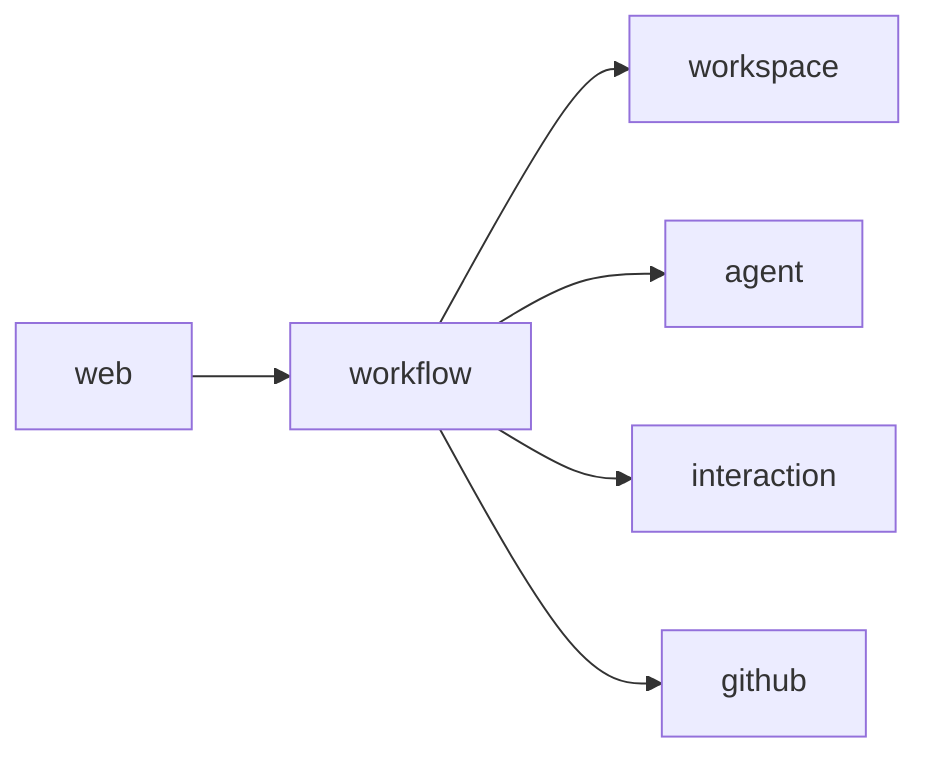

# Ответственность модулей pi-flow

Документ определяет, куда относится новая функциональность в модульном монолите `pi-flow`. Используется при проектировании и реализации, чтобы не принимать решение о размещении кода произвольно.

Общий принцип: каждый модуль — явная единица с собственной ответственностью и публичным контрактом. Бизнес-логика живёт в доменном модуле, инфраструктура — за публичным контрактом. Запрещены циклические зависимости и прямой доступ к внутренностям чужих модулей.

## Диаграмма направлений зависимостей

`workflow` — корень бизнес-координации; `web` зависит от бизнес-модулей, бизнес-модули не зависят от `web`.

---

## Модуль `workflow`

- **Название и назначение**: координация жизненного цикла процесса разработки ПО.
- **Ответственность**: владеет моделью бизнес-процесса — этапами, состояниями и переходами между ними.
- **Что модуль делает**:
  - хранит текущее состояние и этап процесса;
  - выполняет переходы между этапами по согласованным условиям;
  - оркестрирует обращение к `workspace`, `agent`, `interaction`, `github`.
- **Что модуль не делает**:
  - не выполняет локальные Git-операции;
  - не запускает Pi-процессы напрямую;
  - не вызывает GitHub API;
  - не рендерит UI и не обрабатывает HTTP.
- **Каким состоянием/данными владеет**: состояние процесса, текущий этап, пройденные этапы, контрольные точки.
- **Публичные контракты**: запуск процесса, переход/состояние, координация этапов (тип — команды и запросы на оркестрацию).
- **Разрешённые зависимости**: `workspace`, `agent`, `interaction`, `github`.
- **Внешние интеграции**: Temporal подключается через application-слой этого модуля (домен остаётся независимым).
- **Примеры сценариев**:
  - запустить процесс разработки для задачи;
  - перейти с этапа `ANALYZING_REQUIREMENTS` на `DESIGNING_SOLUTION` после подтверждения.
- **Архитектурные ограничения**: не накапливать реализацию внешних систем; доменный код не должен зависеть от Temporal API.

## Модуль `workspace`

- **Название и назначение**: управление локальными репозиториями и Git-операциями.
- **Ответственность**: владеет локальными репозиториями, рабочими ветками, локальными Git-операциями и блокировками репозиториев.
- **Что модуль делает**:
  - проверяет и подготавливает рабочее окружение;
  - создаёт/переключает рабочие ветки;
  - получает и освобождает блокировку репозитория;
  - выполняет коммиты версионируемых артефактов.
- **Что модуль не делает**:
  - не выполняет операции GitHub API;
  - не принимает бизнес-решений о последовательности этапов.
- **Каким состоянием/данными владеет**: пути локальных репозиториев, состояние веток, состояние блокировок.
- **Публичные контракты**: подготовка репозитория, работа с веткой, получение/освобождение блокировки (тип — порты на локальный Git).
- **Разрешённые зависимости**: нет бизнес-модулей.
- **Внешние интеграции**: Git (локально, через CLI или библиотеку).
- **Примеры сценариев**:
  - подготовить чистую рабочую ветку под задачу;
  - зафиксировать утверждённые требования в Git.
- **Архитектурные ограничения**: не смешивать локальные Git-операции с GitHub API.

## Модуль `agent`

- **Название и назначение**: запуск Pi-процессов и фиксация результатов.
- **Ответственность**: управляет запуском Pi Coding Agent в ролях Analyst, Architect, Developer и Reviewer.
- **Что модуль делает**:
  - запускает Pi-процесс в заданной роли в отдельном процессе/сессии;
  - передаёт контекст и задачу агенту;
  - принимает результат и фиксирует технические сведения о выполнении.
- **Что модуль не делает**:
  - не содержит бизнес-правил workflow;
  - не интерпретирует результаты как бизнес-решения.
- **Каким состоянием/данными владеет**: сведения о запусках (идентификатор, роль, статус, технический результат).
- **Публичные контракты**: запуск роли, получение результата (тип — порт запуска агента).
- **Разрешённые зависимости**: нет бизнес-модулей.
- **Внешние интеграции**: Pi Coding Agent.
- **Примеры сценариев**:
  - запустить роль Analyst с передачей задачи и контекста репозитория;
  - запустить роль Reviewer для независимого ревью.
- **Архитектурные ограничения**: роли запускаются в отдельных процессах/сессиях; не удерживать бизнес-состояние workflow.

## Модуль `interaction`

- **Название и назначение**: взаимодействие с пользователем в контрольных точках.
- **Ответственность**: владеет вопросами, ответами, подтверждениями и решениями, ожидающими участия пользователя.
- **Что модуль делает**:
  - регистрирует вопрос/запрос к пользователю;
  - хранит ожидающие решения;
  - принимает ответ/подтверждение пользователя.
- **Что модуль не делает**:
  - не управляет последовательностью этапов workflow;
  - не принимает бизнес-решений по transition.
- **Каким состоянием/данными владеет**: ожидающие решения, вопросы и ответы пользователя.
- **Публичные контракты**: запросить решение, зарегистрировать ответ (тип — порт диалога с пользователем).
- **Разрешённые зависимости**: нет бизнес-модулей.
- **Внешние интеграции**: пользователь (через `web` как канал доставки).
- **Примеры сценариев**:
  - запросить подтверждение требований;
  - получить решение по утверждению проектирования.
- **Архитектурные ограничения**: не содержать логику переходов между этапами.

## Модуль `github`

- **Название и назначение**: взаимодействие с GitHub API.
- **Ответственность**: инкапсулирует операции с GitHub API.
- **Что модуль делает**:
  - получает данные Issue;
  - публикует рабочую ветку;
  - создаёт Pull Request.
- **Что модуль не делает**:
  - не выполняет локальные Git-операции;
  - не содержит бизнес-правил workflow.
- **Каким состоянием/данными владеет**: ссылки на Issue и Pull Request.
- **Публичные контракты**: получить Issue, опубликовать ветку, создать PR (тип — порт на GitHub API).
- **Разрешённые зависимости**: нет бизнес-модулей.
- **Внешние интеграции**: GitHub API (удалённо).
- **Примеры сценариев**:
  - создать Pull Request по итогам финализации;
  - получить данные Issue для анализа требований.
- **Архитектурные ограничения**: не дублировать локальные Git-операции модуля `workspace`.

## Модуль `web`

- **Название и назначение**: API и интерфейс для управления процессами.
- **Ответственность**: предоставляет точку входа для запуска workflow, просмотра состояния и взаимодействия с пользователем.
- **Что модуль делает**:
  - принимает запросы на запуск процесса;
  - отображает текущее состояние workflow;
  - доставляет вопросы/ответы пользователю (`interaction`).
- **Что модуль не делает**:
  - не управляет последовательностью этапов;
  - не запускает Pi напрямую;
  - не содержит бизнес-правил workflow.
- **Каким состоянием/данными владеет**: нет доменного состояния (только транспорт/представление).
- **Публичные контракты**: HTTP API / интерфейс (тип — адаптер ввода).
- **Разрешённые зависимости**: `workflow` и бизнес-модули через их публичные контракты.
- **Внешние интеграции**: браузер/клиент.
- **Примеры сценариев**:
  - пользователь запускает процесс через web;
  - пользователь просматривает текущее состояние и отвечает на вопрос.
- **Архитектурные ограничения**: быть тонким адаптером, не накапливать бизнес-логику.

---

## План последующей реализации модулей (описание, без кода)

Данный раздел описывает шаги создания структуры модулей и настройки проверок. Реализация выполняется отдельным изменением.

### Шаги создания структуры модулей

1. Для каждого из шести модулей (`workflow`, `workspace`, `agent`, `interaction`, `github`, `web`) создать Java-пакет под базовым пакетом приложения (например, `com.hydroyura.agents.piflow.<module>`) с файлом `package-info.java`, помеченным `@org.springframework.modulith.ApplicationModule`.
2. Внутри каждого модуля организовать слои DDD: `api/` (публичные контракты), `application/` (use cases), `domain/` (агрегаты, значения, порты), `infrastructure/` (адаптеры, реализации портов). Не создавать слои, если модуль в них не нуждается (например, `web` — адаптер).
3. Публичные контракты внешних систем реализовать как порты (интерфейсы) в доменном/прикладном слое модуля и адаптеры в `infrastructure/`.

### Настройка Spring Modulith и архитектурных тестов

1. Включить Spring Modulith (стартеры уже присутствуют в `pom.xml`).
2. Добавить архитектурный тест, использующий `ApplicationModules.of(...)` и проверяющий отсутствие циклов между модулями (`verify()`).
3. Добавить проверку изоляции: внутренние классы модуля не должны быть доступны другим модулям (через настройку видимости пакетов и, при необходимости, ArchUnit-правила).
4. Добавить проверку направления зависимостей: `web → workflow → {workspace, agent, interaction, github}`, без обратных зависимостей бизнес-модулей от `web`.

