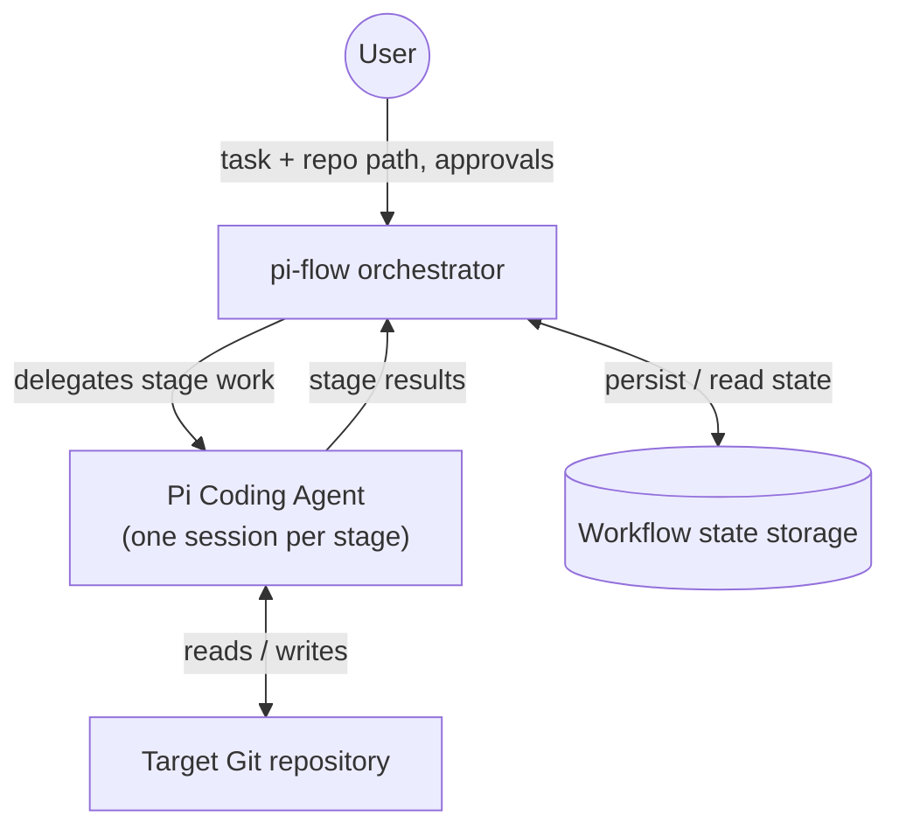

# System Overview

High-level view of **pi-flow**: the participants, what each is responsible for, and how they relate.

OpenSpec is intentionally not listed as a participant — it is the working approach the pi-flow orchestrator and the Pi Coding Agent follow (change artifacts and their validation).

## Participants

| Participant | Type | Responsibility |
|---|---|---|
| **User** | human | Defines the task, selects the target repository, reviews and approves the proposal, and makes final acceptance decisions. |
| **pi-flow** | Spring Boot application (orchestrator) | Manages workflow state and stage transitions, delegates per-stage work to the agent, runs deterministic checks and artifact validation, enforces approval gates, and records outcomes. |
| **Pi Coding Agent** | agent session per stage | Performs the work of the current stage under a distinct role and instructions, and produces stage artifacts. |
| **Workflow state storage** | local store | Persists workflow state, stage outcomes, approval decisions, and failures — execution metadata, not copies of repository artifacts. |
| **Target repository** | Git repository | The project being worked on; separate from the pi-flow repository itself. |

## Component diagram

## Relationships

- **User ↔ pi-flow** — the only human-facing interface. The user drives the workflow and holds approval authority at defined gates.
- **pi-flow → Pi Coding Agent** — the orchestrator delegates each stage's work to a separate agent session under a distinct role. The communication mechanism is not decided yet (see workflow.md - Open questions).
- **Pi Coding Agent → pi-flow** — each stage's results are returned to the orchestrator and explicitly passed to subsequent stages.
- **Pi Coding Agent ↔ Target repository** — the agent reads and writes the project being worked on.
- **pi-flow ↔ Workflow state storage** — workflow state, stage outcomes, approval decisions, and failures are persisted locally; the artifacts themselves live in the target repository.

## Out of scope

Multi-user operation, remote or cloud execution, and a mandatory web UI are non-goals for the initial version.
