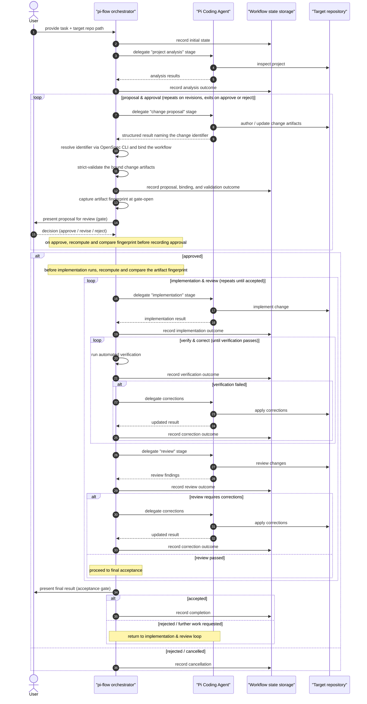

# Workflow

The end-to-end pi-flow workflow, step by step, with the actions of each participant.

> **Provisional.** The stages below and their number are not final and may change. The persistence technology is deliberately out of scope for now (see Open questions). The agent role used at each stage is defined in [`agent-roles.md`](agent-roles.md).
>
> **Stage delegation:** each stage is delegated to Pi in JSON mode (`pi --mode json`), with the orchestrator consuming the JSONL event stream to capture structured stage outcomes.

## Stages

| Stage | Performed by | Outcome |
|---|---|---|
| Task setup | User + orchestrator | Task description and target repository path recorded after a canonical Git worktree preflight |
| Project analysis | Analyst | Findings about the project |
| Change proposal | Architect | Change artifacts in the target repository, plus a structured change identifier |
| Validation & approval | Orchestrator + User | Approved, revisions requested, or rejected/cancelled, guarded by an artifact fingerprint |
| Implementation | Developer | Code changes |
| Automated verification | Orchestrator | Four-valued verification result (`PASSED` / `FAILED` / `NOT_CONFIGURED` / `INFRASTRUCTURE_ERROR`) |
| Review | Reviewer (QA) | Structured verdict (`APPROVED` or `CHANGES_REQUIRED`) and findings extracted from the reviewer's JSON output |
| Corrections | Orchestrator + Developer | Loop back until acceptable |
| Completion | User + orchestrator | Accepted result, further work requested, or cancelled |

## Sequence



## Stage outcomes (conceptual)

The orchestrator records each stage's outcome and distinguishes three conceptual states:

- **Success** — the stage completed and produced its expected result; the workflow proceeds to the next step.
- **Failure** — the stage could not complete (for example, validation or verification failed); the workflow enters the corresponding correction loop or stops, depending on the stage.
- **Requires user intervention** — a decision is needed at a gate (approve / revise / reject a proposal, or accept / reject the final result); the workflow pauses until the user decides.

These states are conceptual only; how they are represented is intentionally not specified here.

## Gate preconditions

Gate commands (`flow-approve`, `flow-reject`, `flow-revise`, `flow-rework`) act only when the workflow is paused at the matching gate stage **and** its status is `AWAITING_USER`. The proposal gates are `VALIDATION_APPROVAL` (approve / reject / request revisions), and the acceptance gate is `ACCEPTANCE` (accept / request further work). `flow-revise` and `flow-rework` accept an optional free-text feedback message (empty when omitted); that feedback is recorded on the workflow, threaded into the next `CHANGE_PROPOSAL` (after a revision request) or `IMPLEMENTATION` (after a further-work request) stage context, and cleared after that stage consumes it. A gate command issued at any other stage, or while the workflow is `IN_PROGRESS` or in a terminal status (`COMPLETED`, `CANCELLED`, `FAILED`), is rejected and leaves the workflow unchanged.

## Pauses, retries, and budgets

The workflow has two non-terminal pause states with distinct meanings:

- **`AWAITING_USER`** — an ordinary gate awaiting a human decision (`VALIDATION_APPROVAL`, `ACCEPTANCE`, or the `NOT_CONFIGURED` verification pause).
- **`PAUSED`** — the workflow was stopped by a technical failure (process crash, timeout, or malformed/unparseable output) of an eligible stage while that stage's technical-retry budget still has attempts remaining.

The two are never reported interchangeably: a gate never reports `PAUSED`, and a technical-failure pause never reports `AWAITING_USER`. `PAUSED` is not terminal.

**`flow-retry`** is the single, manual retry command. It re-runs a stage whose workflow is `PAUSED` at an eligible stage, and it also resolves the `VERIFICATION`+`NOT_CONFIGURED` pause (re-reading the verification configuration fresh, then resuming normal advancement). There is no separate `flow-retry-verification` command; the one `flow-retry` command serves both cases. A rejected `flow-retry` call (wrong state, terminal workflow, or a write stage without acknowledgement) consumes no budget and leaves the workflow unchanged.

**Write-stage acknowledgement.** `CHANGE_PROPOSAL` (which writes OpenSpec change artifacts) and `IMPLEMENTATION` (which writes target-repository source files) are write stages. Retrying either after a technical failure requires the explicit `--acknowledge-partial-changes` flag on `flow-retry`; without it, the request is rejected and the workflow is unchanged. The orchestrator never re-runs a write stage automatically as a technical-failure retry.

**Technical failure vs content correction.** Every attempt is classified as exactly one of `INITIAL`, `TECHNICAL_RETRY`, or `CONTENT_CORRECTION`. A technical failure (crash, timeout, malformed output) is a `TECHNICAL_RETRY` when re-run; a content correction (a `CHANGES_REQUIRED` review verdict, or a verification command that ran to completion and exited nonzero) loops back to `IMPLEMENTATION` as normal control flow. For verification specifically, a nonzero exit within the timeout is a content correction, while a failure to start the command or a timeout is a technical failure.

**Budgets.** Two configurable budgets bound repetition: a maximum of **3** technical-failure attempts per stage-attempt-sequence (`pi-flow.retry.max-technical-retries`) and a maximum of **5** content-correction loops per workflow (`pi-flow.retry.max-content-corrections`). Exhausting either budget marks the workflow `FAILED`; `FAILED` is terminal and immutable, exactly like `COMPLETED` and `CANCELLED`. Auto-retry is disabled by default, and this change adds no configuration to enable unattended retry — every technical-failure re-run is an explicit `flow-retry` invocation.

## Participant actions per step

1. **Task setup**
   - *User*: provides the task description and the path to an existing Git repository. No change identifier is supplied at this point.
   - *Orchestrator*: resolves the path to a canonical Git worktree root via `git rev-parse` before creating any workflow; a non-existent or non-worktree path is rejected. Then records the initial workflow state.
2. **Project analysis**
   - *Orchestrator*: delegates the stage to the Analyst.
   - *Analyst*: inspects the target repository and returns findings.
   - *Orchestrator*: records the analysis outcome and passes the findings to the next stage.
3. **Change proposal**
   - *Orchestrator*: delegates the stage to the Architect, requiring a structured result naming the OpenSpec change identifier created or revised.
   - *Architect*: authors (or, on a later pass, updates) the change artifacts in the target repository and reports the change identifier.
   - *Orchestrator*: resolves the identifier against the target repository's active OpenSpec changes via the OpenSpec CLI, binds the workflow to it on first success (revisions stay bound to the same identifier), and records the proposal outcome. A missing, ambiguous, path-escaping, or unresolvable identifier fails the stage with no later-stage agent call.
4. **Validation & approval** — a loop that repeats on revisions:
   - *Orchestrator*: strict-validates the bound change's artifacts (equivalent to `openspec validate <changeId> --strict`) before presenting the gate, records the validation outcome, and captures an artifact fingerprint over the change's `proposal.md`, `design.md`, `specs/`, and `tasks.md` (with `tasks.md` checkbox markers normalized) at gate-open time.
   - *User*: reviews the proposal and decides:
     - **approve** → the orchestrator recomputes and compares the fingerprint before recording the approval, then proceeds to implementation; on a mismatch the approval is not recorded, the artifacts are re-validated, and the gate reopens with a fresh fingerprint;
     - **request revisions** → the Architect revises the same bound change, and the loop repeats (validate again, capture the fingerprint again, review again);
     - **reject / cancel** → the workflow ends and the cancellation is recorded.
   - *Orchestrator*: immediately before the implementation stage runs, recomputes and compares the fingerprint again; on a mismatch it blocks implementation, re-validates, and reopens the gate. Toggling a `tasks.md` checkbox alone never counts as drift.
5. **Implementation**
   - *Orchestrator*: delegates the stage to the Developer with the approved artifacts.
   - *Developer*: implements the change in the target repository.
   - *Orchestrator*: records the implementation outcome.
6. **Automated verification** — a loop that repeats until verification passes:
   - *Orchestrator*: reads the target repository's verification configuration file fresh on every attempt and runs the configured command deterministically, recording a four-valued outcome.
   - *Outcome `PASSED`*: the workflow proceeds to review.
   - *Outcome `FAILED`*: the configured command ran to completion and reported a problem (nonzero exit within the timeout); the Developer applies corrections and the loop repeats, bounded by the content-correction budget. The workflow does not proceed to review until verification passes.
   - *Outcome `NOT_CONFIGURED`*: no configuration file exists. The workflow pauses in `AWAITING_USER` at the `VERIFICATION` stage — not `PAUSED`, not `FAILED`, not a correction loop — and is recoverable via `flow-retry` once the file is created, in the same running process, with no technical-retry budget consumed.
   - *Outcome `INFRASTRUCTURE_ERROR`*: the configuration file exists but is invalid, the command cannot be started, or the command times out. This is a technical failure of the verification stage: the workflow pauses in `PAUSED` (not `AWAITING_USER`) under the technical-retry budget, and `flow-retry` re-runs it.

   **Verification configuration.** The command to run is read from a per-target-repository JSON file (default `.pi-flow/verify.json`, path overridable via `pi-flow.verification.config-path`), re-read fresh on every attempt so a user can create or fix it without restarting the application. The fixed schema is a JSON object with `command` (non-empty array of strings), `timeoutSeconds` (positive integer), and optional `workingDirectory` (defaults to the target repository root). The verifier never invokes any command other than the one in this user-authored file.
7. **Review** — a loop that repeats on corrections:
   - *Orchestrator*: delegates the stage to the Reviewer with the task, approved artifacts, code changes, and verification results.
   - *Reviewer (QA)*: evaluates the implementation against them and returns findings.
   - *Orchestrator*: records the review outcome and routes on the extracted `ReviewVerdict` (`APPROVED` or `CHANGES_REQUIRED`), not on whether the reviewer process merely ran without crashing.
   - *If the verdict is `CHANGES_REQUIRED`*: the Developer applies corrections, then verification and review repeat; if the verdict is `APPROVED`, the workflow proceeds to final acceptance.

   **Reviewer output contract.** The reviewer's final text is treated as a single candidate JSON document, never scanned for a keyword substring. The orchestrator uses the content of the one ```` ```json ```` fenced block when exactly one is present, or the whole trimmed text when none is present; more than one ```` ```json ```` block is ambiguous. The candidate document must parse as a JSON object with `verdict` (a string, exactly `"APPROVED"` or `"CHANGES_REQUIRED"`) and `findings` (a JSON array of strings, which may be empty). Any deviation — invalid JSON, a non-object document, a missing or wrong-typed `verdict` or `findings`, or an ambiguous number of blocks — fails closed: the workflow is marked `FAILED`, never silently treated as `CHANGES_REQUIRED` or `APPROVED`.
8. **Corrections**
   - *Orchestrator*: routes the workflow back into the verification/review loop.
   - *Developer*: applies corrections to the target repository.
9. **Completion** — the final gate, reached only after successful verification and review:
   - *Orchestrator*: presents the final result.
   - *User*: decides:
     - **accept** → the completion is recorded;
     - **reject / request further work** → the workflow returns to the implementation & review loop.

## Open questions

- **Persistence technology** — the concrete storage behind "Workflow state storage" (embedded database vs file) is unresolved.
- **Retry / correction limits** — resolved: retries and correction loops are bounded by the configurable technical-retry and content-correction budgets described above (defaults 3 and 5).
