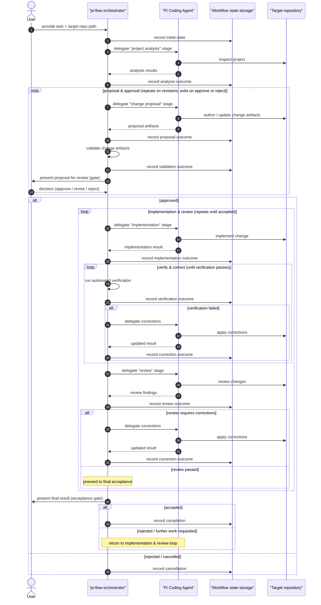

# Workflow

The end-to-end pi-flow workflow, step by step, with the actions of each participant.

> **Provisional.** The stages below and their number are not final and may change. Agent roles are roles of the same Pi Coding Agent, not separate services. The Spring ↔ agent communication mechanism and the persistence technology are deliberately out of scope for now (see Open questions).

## Stages

| Stage | Performed by | Outcome |
|---|---|---|
| Task setup | User + orchestrator | Task description and target repository path recorded |
| Project analysis | Agent | Findings about the project |
| Change proposal | Agent | Change artifacts in the target repository |
| Validation & approval | Orchestrator + User | Approved, revisions requested, or rejected/cancelled |
| Implementation | Agent | Code changes |
| Automated verification | Orchestrator | Verification passed or failed |
| Review | Agent | Review passed or corrections required |
| Corrections | Orchestrator + agent | Loop back until acceptable |
| Completion | User + orchestrator | Accepted result, further work requested, or cancelled |

## Sequence

## Stage outcomes (conceptual)

The orchestrator records each stage's outcome and distinguishes three conceptual states:

- **Success** — the stage completed and produced its expected result; the workflow proceeds to the next step.
- **Failure** — the stage could not complete (for example, validation or verification failed); the workflow enters the corresponding correction loop or stops, depending on the stage.
- **Requires user intervention** — a decision is needed at a gate (approve / revise / reject a proposal, or accept / reject the final result); the workflow pauses until the user decides.

These states are conceptual only; how they are represented is intentionally not specified here.

## Participant actions per step

1. **Task setup**
   - *User*: provides the task description and the path to an existing Git repository.
   - *Orchestrator*: records the initial workflow state.
2. **Project analysis**
   - *Orchestrator*: delegates the stage to the agent.
   - *Agent*: inspects the target repository and returns findings.
   - *Orchestrator*: records the analysis outcome and passes the findings to the next stage.
3. **Change proposal**
   - *Orchestrator*: delegates the stage to the agent.
   - *Agent*: authors (or, on a later pass, updates) the change artifacts in the target repository.
   - *Orchestrator*: records the proposal outcome.
4. **Validation & approval** — a loop that repeats on revisions:
   - *Orchestrator*: validates the change artifacts and records the validation outcome.
   - *User*: reviews the proposal and decides:
     - **approve** → proceed to implementation;
     - **request revisions** → the agent revises the proposal, and the loop repeats (validate again, review again);
     - **reject / cancel** → the workflow ends and the cancellation is recorded.
5. **Implementation**
   - *Orchestrator*: delegates the stage to the agent with the approved artifacts.
   - *Agent*: implements the change in the target repository.
   - *Orchestrator*: records the implementation outcome.
6. **Automated verification** — a loop that repeats until verification passes:
   - *Orchestrator*: runs the configured checks deterministically and records the verification outcome.
   - *If verification fails*: the agent applies corrections and the loop repeats; the workflow does not proceed to review until verification passes.
7. **Review** — a loop that repeats on corrections:
   - *Orchestrator*: delegates the stage to the agent with the task, approved artifacts, code changes, and verification results.
   - *Agent*: evaluates the implementation against them and returns findings.
   - *Orchestrator*: records the review outcome.
   - *If corrections are required*: the agent applies corrections, then verification and review repeat; if the review passes, the workflow proceeds to final acceptance.
8. **Corrections**
   - *Orchestrator*: routes the workflow back into the verification/review loop.
   - *Agent*: applies corrections to the target repository.
9. **Completion** — the final gate, reached only after successful verification and review:
   - *Orchestrator*: presents the final result.
   - *User*: decides:
     - **accept** → the completion is recorded;
     - **reject / request further work** → the workflow returns to the implementation & review loop.

## Open questions

- **Agent roles** — the concrete set of per-stage roles is not fixed yet; roles are roles of the same Pi Coding Agent, not separate services.
- **Spring ↔ agent communication** — the mechanism by which the orchestrator invokes and talks to the agent is bracketed out for this step.
- **Persistence technology** — the concrete storage behind "Workflow state storage" (embedded database vs file) is unresolved.
- **Retry / correction limits** — the loops above are conceptual; the number of revision/correction rounds is not decided.
