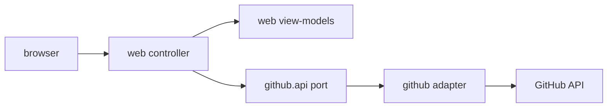

# Design

## Context

Сейчас `web` содержит `WelcomeController` и `index.html`; Spring MVC и Thymeleaf уже подключены. Модуль является входным адаптером и не должен содержать DDD-слои или бизнес-правила.

## Goals / Non-Goals

**Goals:** создать основу страниц и изолированные view-модели.

**Non-Goals:** запуск Workflow, Git-операции, собственный REST-клиент GitHub и доменное состояние.

## Decisions

### D1: Spring MVC + Thymeleaf
**Решение:** сохранить уже принятый стек и `@Controller` в `web` с шаблонами в `templates/`. **Почему:** зависимости и welcome-страница уже существуют. **Альтернатива:** SPA — отклонена как избыточная для локального MVP.

### D2: View-модели web
**Решение:** контроллеры маппят `RepositorySummary`/`IssueSummary` в собственные view-record. **Почему:** шаблоны не зависят от публичного контракта данных github. **Альтернатива:** передавать api-модели напрямую — отклонена.

### D3: Поток данных

Контроллеры остаются тонкими; ошибки преобразуются в UI на последующих changes.

## Risks / Trade-offs

- Серверный рендеринг требует полного перехода страницы → приемлемо для ручного MVP.
- Изменение github-контракта потребует маппинга, но не связывает шаблоны с инфраструктурой.

## Open Questions

Нет: UI и границы определены исходным заданием.
