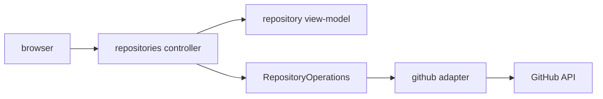

# Design

## Context

Публичный порт `RepositoryOperations.listRepositories(PageRequest)` возвращает `RepositoryPage(items, page, perPage, hasNext)`. Web уже имеет основу UI (23) и обработку конфигурации (24).

## Goals / Non-Goals

**Goals:** отображать доступные PAT репозитории, переходы и серверную пагинацию.

**Non-Goals:** новый REST-клиент, фильтрация бизнес-правилом, изменение репозиториев.

## Decisions

### D1: Интеграция через порт
**Решение:** controller/service web вызывает только `github.api.RepositoryOperations`; запрещены `RestClient`, `github.infrastructure`, `workspace`, `agent`. **Почему:** сохраняется направление зависимостей и единая реализация API. **Альтернатива:** HTTP в controller — отклонена.

### D2: Пагинация
**Решение:** URL содержит page/perPage, next определяется `hasNext`, previous — page > 1. **Почему:** использует уже реализованный контракт и не угадывает число страниц.

### D3: Поток

## Risks / Trade-offs

- При изменении размера страницы ссылки должны сохранять perPage → параметры считаются частью контекста.
- Ошибки доступа не дают результата → страница должна иметь безопасную ветку ошибки.

## Open Questions

Нет.
