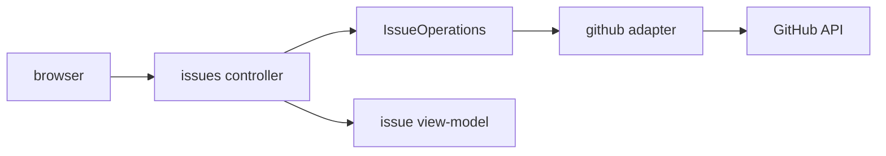

# Design

## Context

`IssueOperations.listIssues(owner, repository, IssueFilter, PageRequest)` возвращает `IssuePage`, а `IssueSummary` содержит номер, title, state и url. Контекст репозитория естественно передаётся URL.

## Goals / Non-Goals

**Goals:** серверно отрендерить список Issues, ссылки и пагинацию.

**Non-Goals:** создание/изменение Issues, PR, Workflow и Git.

## Decisions

### D1: Публичный порт github
**Решение:** использовать только `IssueOperations`; web не знает `RestGithubApiAdapter`. **Почему:** исключается дублирование клиента.

### D2: Контекст URL
**Решение:** owner/repository являются path-параметрами маршрута Issues, page/perPage — query-параметрами. **Почему:** ссылки воспроизводимы и сохраняют выбранный репозиторий.

### D3: Поток и маппинг

## Risks / Trade-offs

- Специальные символы owner/repository требуют стандартное URL-кодирование.
- Issue API может вернуть pull request entries, но MVP отображает поля общего `IssueSummary`.

## Open Questions

Нет.
