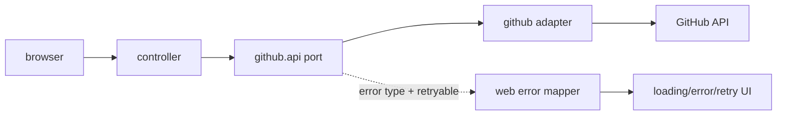

# Design

## Context

GitHub-порт определяет `GithubException.ErrorType` и `retryable()`. Страницы репозиториев и Issues уже получают данные через порты и сохраняют контекст в URL.

## Goals / Non-Goals

**Goals:** единообразные loading/error/empty/success состояния, retry и адаптивный локальный layout.

**Non-Goals:** SPA, polling, сложная дизайн-система и изменение github.

## Decisions

### D1: Маппинг ошибок
**Решение:** централизованный web mapper преобразует configuration/authentication/not-found/rate-limit/network/server в безопасные сообщения. **Почему:** одинаковое поведение страниц. **Альтернатива:** try/catch в каждом controller — отклонено из-за расхождений.

### D2: Retry
**Решение:** retry-ссылка повторяет GET с теми же path/query параметрами. **Почему:** GET идемпотентен, контекст не теряется. **Альтернатива:** POST для retry — не нужен.

### D3: Диагностический поток

## Risks / Trade-offs

- При серверном рендеринге loading виден в момент отправки/перехода → добавляется HTML-форма/link state без смены архитектуры.
- Адаптивность без JS ограничена CSS → фиксируются минимальная ширина и отсутствие горизонтального overflow.

## Open Questions

Нет.
