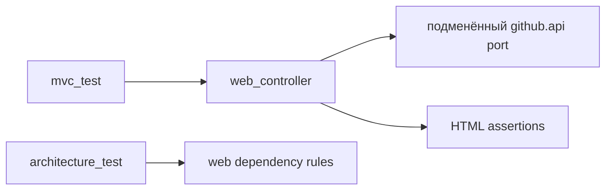

# Design

## Context

Web должен быть тонким адаптером над `github.api`; production-контракты уже реализованы, а тесты могут подменять Spring beans портов. Финальный change проверяет результаты 23–27.

## Goals / Non-Goals

**Goals:** MVC-тесты страниц, fake-порты, безопасность сообщений и архитектурные запреты.

**Non-Goals:** E2E-тестирование реального GitHub, запуск Workflow, тестирование внутреннего REST-адаптера github.

## Decisions

### D1: MVC slice tests
**Решение:** использовать web MVC slice с mock/fake `RepositoryOperations` и `IssueOperations`. **Почему:** тестируется HTTP/view без сети. **Альтернатива:** интеграция с GitHub — недетерминирована и раскрывает секреты.

### D2: Проверка утечек
**Решение:** использовать sentinel PAT и искать его в response body, captured logs и exception text. **Почему:** проверяется отрицательное свойство явно.

### D3: Архитектурная проверка
**Решение:** Modulith/ArchUnit правила запрещают imports `github.infrastructure`, REST-классы, workspace/agent и запуск Workflow в web.

## Risks / Trade-offs

- Slice-тесты могут не поймать ошибку полного шаблонного wiring → добавляется общий `./mvnw -q test`.
- Проверка логов зависит от capture-механизма → sentinel проверяется также в HTML и exception message.

## Open Questions

Нет.
