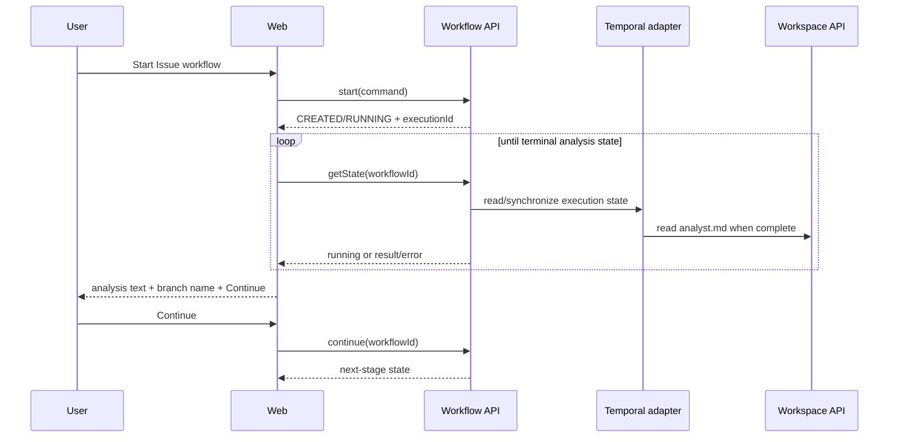

# Design

## Context

См. `proposal.md` и delta-спеки. `WorkflowController` сейчас отображает только результат fire-and-forget запуска, `WorkflowState` содержит лишь статус/этап/execution id, а `InMemoryWorkflowRepository` не получает обратный результат Temporal. Анализ уже создаёт `.pi-flow/analysis/analyst.md` в workspace и возвращает путь/метаданные; полный текст должен читаться из workspace, а не из Temporal history.

## Goals / Non-Goals

**Goals:**

- Сделать прогресс Analyst наблюдаемым в обычном web UI через polling публичного workflow-контракта.
- Синхронизировать результат и ошибку execution с application-состоянием workflow.
- Доставить текст артефакта и branch suggestion через публичные контракты без утечки Temporal.
- Дать пользователю однозначное действие продолжения только после валидного анализа.

**Non-Goals:**

- Реализация Architect, Developer, Reviewer или QA.
- Pull Request, approval, ручной выбор branch name, генерация OpenSpec Proposal.
- Новая БД, новый модуль, Temporal UI или передача полного анализа через Temporal history.

## Decisions

### D1. Публичное состояние как источник UI

Расширить `workflow.api.WorkflowState` сериализуемыми полями прогресса/результата и добавить публичную операцию продолжения. Web вызывает только `WorkflowOperations`; Temporal SDK и agent API остаются за application/infrastructure границами.

Альтернатива — читать Temporal напрямую из web — отклонена из-за нарушения границ и требования не использовать Temporal UI/SDK в web.

### D2. Polling вместо push

После `start` страница запрашивает состояние workflow с фиксированным интервалом, пока состояние не станет успешным или ошибочным. Интервал и остановка polling фиксируются тестами; повторный запрос не создаёт новый workflow.

Альтернатива — WebSocket/SSE — отклонена как избыточная для текущего in-memory состояния и минимального инкремента.

### D3. Обратная синхронизация execution

Infrastructure adapter/worker callback получает завершение Temporal execution и преобразует его в application-команду обновления результата. Обновление идемпотентно по workflow id/execution id; при failure сохраняется терминальная ошибка. Домен не импортирует Temporal типы.

Поскольку текущий Temporal adapter использует `stub.start`, implementation SHALL выбрать один из двух эквивалентных инфраструктурных механизмов: отдельный наблюдатель execution или синхронизацию через activity/result callback. Выбранный механизм обязан сохранять тот же публичный контракт и не блокировать HTTP-запрос запуска.

### D4. Текст читается через workspace

После получения artifact path workflow/application обращается к новому безопасному workspace API, который разрешает чтение только ожидаемого файла под корнем workspace. В публичное состояние попадает текст и branch name, но не абсолютный локальный путь как единственный UI-контракт; Temporal result остаётся компактным.

### D5. Branch name принадлежит Analyst

Ресурс роли Analyst явно требует отдельный branch suggestion. Activity извлекает его из структурированного результата/артефакта и валидирует как латинское Git-имя; web только отображает значение и не предлагает пользователю вводить его вручную.

### D6. Продолжение — отдельная команда

Кнопка вызывает публичную операцию `continue`, идентифицированную workflow id, с сохранённым branch name. Workflow принимает её только после успешного анализа и переводит состояние на следующий этап; повторное или преждевременное продолжение отклоняется без изменения состояния.

## Interaction

## Risks / Trade-offs

- **[Risk]** In-memory state теряется при рестарте → **Mitigation:** не добавлять БД в этот change; явно сохранить ограничение и покрыть отсутствие workflow типизированной ошибкой.
- **[Risk]** Polling создаёт повторные запросы → **Mitigation:** ограниченный интервал, остановка на terminal state, идемпотентный `getState`.
- **[Risk]** Temporal execution завершится, но callback не обновит состояние → **Mitigation:** integration-тест успешного и failed execution; состояние не показывать успешным до валидации artifact.
- **[Risk]** Analyst предложит небезопасное имя ветки → **Mitigation:** строгая Git-валидация до публикации результата.
- **[Risk]** Большой текст перегружает HTML → **Mitigation:** в текущем change отображать полный файл как требуется; лимиты/постраничность не вводить без отдельного требования.

## Migration Plan

1. Расширить публичные модели workflow/workspace и добавить доменные переходы результата/продолжения.
2. Реализовать синхронизацию Temporal execution и чтение artifact через workspace.
3. Обновить ресурс Analyst и валидацию branch name.
4. Обновить web controller/template для polling, result/error и Continue.
5. Добавить unit, MVC и Temporal integration tests; выполнить compile/test/validation.

Rollback: убрать web polling и Continue, вернуть отображение начального состояния; новые поля публичного результата сделать обратно совместимыми/необязательными. Данные в новой БД не мигрируются, поскольку БД не добавляется.

## Open Questions

Нет вопросов, меняющих выбранный scope или контракты.
