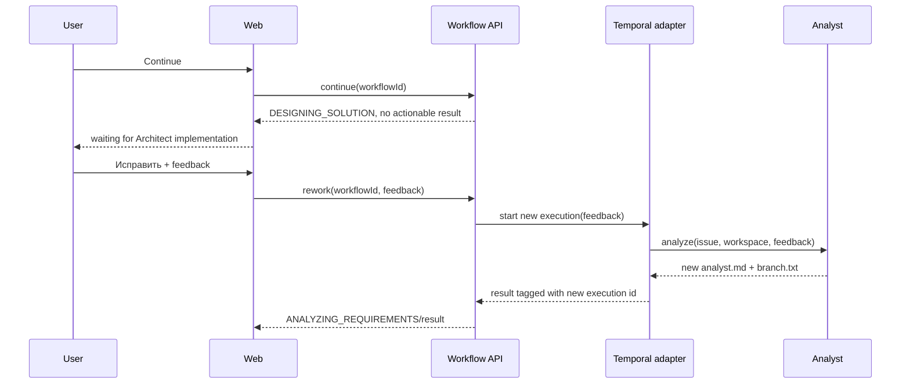

# Design

## Context

См. `proposal.md` и delta-спеки. Сейчас `ContinueWorkflowCommand` переводит агрегат на `DESIGNING_SOLUTION`, но сохраняет `analysisText`/`branchName`, а Temporal execution завершается после Analyst. В `workflow-status.html` результат определяется наличием `analysisText`, поэтому UI визуально остаётся на старом экране. Rework-команды и передачи feedback нет.

## Goals / Non-Goals

**Goals:**

- Сделать Continue одноразовым и визуально наблюдаемым.
- Представить `DESIGNING_SOLUTION` как достигнутый, но пока не исполняемый этап.
- Перезапускать только Analyst с feedback и новым execution/run id.
- Исключить stale-result race между старым и новым execution.

**Non-Goals:**

- Реализация Architect или любого activity после Analyst.
- Хранение feedback/результата в новой БД.
- Передача полного feedback через Temporal history отдельным payload-документом.
- Выбор branch name пользователем, PR, approval и новые модули.

## Decisions

### D1. Отдельная публичная rework-команда
Добавить в `workflow.api` команду с `workflowId` и feedback и операцию rework в `WorkflowOperations`. Web не вызывает agent или Temporal напрямую.

Альтернатива — переиспользовать Continue с флагом — отклонена: разные действия имеют разные доменные переходы и права на изменение результата.

### D2. Доменный reset перед новым execution
Агрегат добавит переход rework: очистит `analysisText` и `branchName`, установит `ANALYZING_REQUIREMENTS`, сохранит checkpoint с фактом rework и оставит статус `RUNNING`. Application после этого запускает новый execution и заменяет execution id только после успешного старта; при ошибке запуска состояние не публикуется как успешный rework.

### D3. Feedback как часть инструкции Analyst
Feedback добавляется в `WorkflowAnalysisInput` и в формируемую activity-инструкцию. Он не помещается в отдельную большую Temporal history-команду и не хранится в доменном состоянии после запуска. Публичный API agent получает его как поле входной модели.

### D4. Устаревшие execution отбрасываются
Результат execution применяется только если его execution id совпадает с актуальным execution id workflow. Это предотвращает возврат старого анализа после rework. Для этого application/infrastructure сохраняют идентификатор запуска рядом с результатом и делают синхронизацию идемпотентной.

### D5. Continue только меняет UI-доступное состояние
`continueWorkflow` вызывает доменный переход и не запускает Architect. `WorkflowState` после перехода не отдаёт старый результат как actionable: либо поля результата очищаются в домене при Continue, либо application формирует состояние с `analysisText=null`/`branchName=null` для не-аналитического этапа. Выбор реализации должен сохранить внешний контракт сценариев.

### D6. UI — серверная форма с modal/dialog
Кнопка «Исправить» открывает `dialog` или эквивалентное окно с textarea и отдельной кнопкой отправки. POST rework возвращает на track; при пустом feedback остаётся на странице с сообщением валидации. После принятого rework polling снова работает для `ANALYZING_REQUIREMENTS`.

### D7. Повторный branch suggestion
Новый запуск Analyst всегда пишет `.pi-flow/analysis/branch.txt` заново и проходит существующую валидацию латинского Git-имени. Старое имя не переносится в новый результат.

## Interaction

## Risks / Trade-offs

- **[Risk]** Architect не запущен, поэтому этап может долго оставаться `DESIGNING_SOLUTION` → **Mitigation:** UI явно показывает «этап ожидает реализации» и не предлагает Continue.
- **[Risk]** Старое execution завершится после rework → **Mitigation:** проверка execution id перед применением результата и тест race-сценария.
- **[Risk]** Feedback может быть большим → **Mitigation:** передавать его как обычное входное поле инструкции, ограничить размер на web/application уровне измеримым лимитом, если такой лимит уже принят; не добавлять его в Temporal history отдельным документом.
- **[Risk]** In-memory repository теряет состояние после рестарта → **Mitigation:** сохранить существующее ограничение и не вводить БД в этом change.

## Migration Plan

1. Расширить API-команды и доменные переходы, не меняя существующий start-контракт.
2. Добавить rework orchestration и feedback в analysis input/instruction.
3. Исправить публикацию состояния после Continue и защиту от stale execution.
4. Обновить controller/template и добавить MVC, domain, activity и Temporal tests.
5. Выполнить Maven tests и `openspec validate`.

Rollback: удалить web rework action и отключить повторный execution; существующий первый Analyst и одноразовый Continue должны продолжать работать.

## Open Questions

Нет вопросов, меняющих scope или проверяемое поведение.