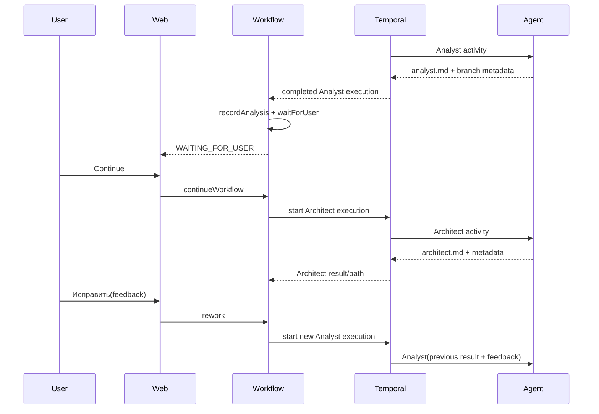

# Design

## Context

См. `proposal.md` и delta-спеки. Сейчас `PiFlowWorkflowImpl` выполняет preparation и Analyst, после чего Temporal execution завершается; `WorkflowService` синхронизирует результат polling-ом, но не вызывает `waitForUser()`. `continueWorkflow` только меняет доменный этап, а Architect activity и его ресурсы отсутствуют. При rework в Analyst передаётся feedback, но не предыдущий текст анализа.

## Goals / Non-Goals

**Goals:**

- Сохранить отдельное execution на каждый исполняемый этап и сделать ожидание пользователя явным.
- Запускать Architect только после Continue и повторно запускать Analyst только после Rework.
- Хранить большие результаты в workspace, а в execution/API передавать путь и метаданные.
- Не нарушить границы модулей и существующие Analyst branch/artifact checks.

**Non-Goals:**

- Длинный Temporal workflow с сигналами и ожиданием внутри Temporal.
- Developer, Reviewer, QA, реализация, pull request, approval gates и генерация OpenSpec Proposal.
- Новая БД, persistence-модуль или изменение workspace lifecycle за пределами нужных artifact reads.

## Decisions

### D1. Отдельное execution на этап
Сохраняется модель «одно execution на один запуск этапа»: Analyst завершает execution, домен остаётся `WAITING_FOR_USER`; Continue/Rework создают новое execution. Это минимально совместимо с уже существующим rework и не требует сигналов, durable timers или долгоживущего Temporal state.

Альтернатива — один workflow с `Workflow.await` и сигналами — отклонена: она меняет transport/orchestration model, усложняет повторный этап и не нужна для паузы, которая уже моделируется доменом и polling.

### D2. Этап определяется командой execution
Application port расширяется типизированной командой/режимом этапа (Analyst или Architect), а Temporal adapter выбирает соответствующее execution workflow. Workflow id для новых запусков должен поддерживать отдельный execution/run id или Temporal-compatible unique id, чтобы Architect не конфликтовал с завершённым Analyst.

### D3. Переход в ожидание выполняется при синхронизации результата
После `SUCCEEDED` и чтения валидного `analyst.md` service вызывает `recordAnalysis(...)`, затем `waitForUser()`, сохраняя branch/text. Это гарантирует, что ожидание наступает только после проверки артефакта. Temporal execution при этом остаётся завершённым, но доменный Workflow не становится `COMPLETED`.

### D4. Continue и Rework имеют разные orchestration paths
Continue сначала проверяет состояние `WAITING_FOR_USER`, вызывает `resume()` и завершает Analyst stage, затем запускает Architect activity с тем же workspace. Rework сохраняет предыдущий analysis text до формирования входа, вызывает доменный rework, затем запускает новый Analyst execution с feedback и previous-analysis context. При ошибке запуска workflow переводится в `FAILED` согласно существующей ошибочной модели, а успешное состояние не публикуется.

### D5. Architect artifact contract
Architect использует `.pi-flow/design/architect.md`. Activity проверяет успешный AgentRunResult, существование/читаемость/непустоту файла и возвращает workspace path, artifact path/size и run metadata. Полный текст читается через `WorkspaceOperations`; Temporal history не используется как хранилище design текста.

### D6. Ресурсы и контекст ролей
Добавляются `roles/architect/system-prompt.md` и skill resources. Architect instruction содержит Issue, workspace и путь design artifact. Rework instruction содержит feedback и предыдущий анализ (предпочтительно путь workspace плюс текст в instruction только в пределах существующего контракта), чтобы агент мог сопоставить замечания с исходным результатом.

### D7. UI state mapping
`workflow-status.html` показывает Analyst result и две формы только при `WAITING_FOR_USER` на `ANALYZING_REQUIREMENTS`. Для `RUNNING` показывается spinner, для `DESIGNING_SOLUTION` — Architect running/waiting state и design result, если он уже доступен. Polling не должен повторно показывать action buttons после принятия действия.

### D8. Проверка stale execution
Application применяет результат только для актуального execution id. При смене execution id старое завершение не должно перезаписывать новый этап или возвращать Workflow в `WAITING_FOR_USER`.

## Interaction

## Risks / Trade-offs

- **[Risk]** In-memory repository теряет ожидание и execution id после рестарта → **Mitigation:** сохранить существующее ограничение; persistence не входит в scope.
- **[Risk]** Завершённое старое execution может быть опрошено после Rework → **Mitigation:** связывать результат с актуальным execution id и тестировать stale-result race.
- **[Risk]** Один Temporal workflow id не позволяет повторный запуск после завершения → **Mitigation:** адаптер генерирует уникальный execution/run identifier при сохранении бизнес-id workflow.
- **[Risk]** Architect может записать невалидный файл → **Mitigation:** обязательная activity validation по аналогии с Analyst.
- **[Risk]** Предыдущий анализ и feedback увеличивают instruction → **Mitigation:** передавать путь артефакта как основной контекст и ограничить inline text существующим публичным контрактом; не отправлять его в отдельный history payload.

## Migration Plan

1. Расширить доменные переходы и application state synchronization, не меняя статусы.
2. Добавить stage-aware execution contract и Architect activity/resources.
3. Перевести web actions на `WAITING_FOR_USER` и обновить rendering/polling.
4. Добавить тесты domain, service, activity, adapter/integration, MVC и module boundaries.
5. Запустить `./mvnw test` и `openspec validate`.

Rollback: отключить Architect start и вернуть Continue к отображению этапа без запуска activity; при этом сохранить ожидание и Rework только если rollback совместим с публичными сценариями.

## Open Questions

Нет вопросов, влияющих на scope или проверяемые контракты.
