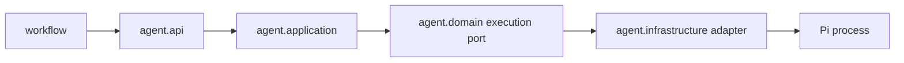

# Design

## Context

`agent` — листовой Spring Modulith-модуль, который запускает Pi и возвращает технический результат. `workflow` видит только `agent.api`; бизнес-переходы, Git и GitHub остаются вне модуля.

## Goals / Non-Goals

**Goals:** публичный порт запуска, входная/выходная модели, классификация ошибок и изоляция деталей Pi. **Non-Goals:** выбор CLI/RPC, реальный subprocess, timeout, отмена и роли как отдельные сервисы.

## Decisions

### D1: Публичный порт в `agent.api`
**Решение:** экспортировать порт запуска и immutable-модели команды/результата. **Почему:** workflow зависит от поведения, а не от процесса. **Альтернатива:** экспортировать ProcessBuilder/CLI DTO — отклонена из-за утечки инфраструктуры.

### D2: Внутренний driven-порт
**Решение:** application-слой реализует публичный порт и вызывает порт исполнения в `agent.domain`; адаптеры будут в `agent.infrastructure`. **Почему:** инверсия зависимостей и заменяемость Pi. **Альтернатива:** вызывать процесс из API — отклонена.

### D3: Технический результат
**Решение:** контракт содержит идентификатор запуска, статус, stdout-текст, stderr-текст, exit code и метаданные. **Почему:** этого достаточно для технической фиксации; бизнес-интерпретация остаётся workflow. **Альтернатива:** доменная модель решения — отклонена.

### D4: Ошибки
**Решение:** различать ошибку валидации/подготовки, запуска, выполнения и обработки результата. **Почему:** вызывающая сторона получает проверяемую причину без исключений инфраструктуры.

### D5: Границы

**Почему:** схема фиксирует направление зависимостей и скрывает Pi.

## Risks / Trade-offs

- Модель может расшириться после проверки фактического CLI; минимальный контракт снижает риск.
- Отдельные типы ошибок требуют маппинга, но исключают зависимость от Process API.

## Open Questions

- Интерфейс CLI vs RPC проверяется в Change 3; до этого публичный контракт не зависит от транспорта.
- Нужен ли структурированный результат сверх текста и exit code — уточнить по фактическому формату Pi.
- Как хранятся профили ролей — уточнить в Change 4.
