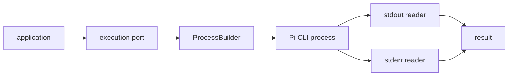

# Design

## Context

Фактические возможности Pi и требования к рабочему процессу допускают запуск отдельного CLI-процесса. Нужно получить полный технический вывод и не допустить взаимной блокировки stdout/stderr.

## Goals / Non-Goals

**Goals:** subprocess, передача задачи, параллельный drain потоков, exit code и освобождение ресурсов. **Non-Goals:** RPC-адаптер, бизнес-обработка, повторные попытки и workflow lifecycle.

## Decisions

### D1: CLI как основной интерфейс
**Решение:** использовать `ProcessBuilder` и отдельный Pi CLI subprocess. RPC откладывается. **Почему:** CLI доступен локально, поддерживает отдельный процесс и позволяет управлять его stdin/stdout/stderr и жизненным циклом. **Альтернатива:** RPC — требует подтверждённого endpoint/session API и не нужен для текущего контракта.

### D2: Передача инструкции
**Решение:** использовать поддерживаемый Pi CLI-интерфейс; конкретный режим stdin/аргумент фиксируется после проверки установленной версии, но данные не shell-экранируются вручную. **Почему:** исключаются инъекции и сохраняется единый subprocess. **Альтернатива:** временный shell-файл — повышает риск утечки.

### D3: Два независимых reader-а
**Решение:** stdout и stderr читаются независимо до завершения процесса. **Почему:** заполнение одного буфера не блокирует Pi. **Альтернатива:** последовательное чтение — отклонено.

### D4: Ресурсы
**Решение:** процесс, stdin и reader-ресурсы закрываются в детерминированном lifecycle после сбора вывода. **Почему:** не оставлять дескрипторы и дочерние процессы.

### D5: Поток

## Risks / Trade-offs

- CLI-формат может различаться между версиями Pi; проверка версии и контрактная абстракция снижают риск.
- Хранение полного вывода увеличивает память; лимиты относятся к отдельному решению, но reader не должен прекращать drain из-за размера.

## Open Questions

- Нужен ли Pi структурированный JSON-результат вместо текста и exit code — уточнить до реализации результата.
- Механизм отмены через `process.destroy()` уточняется в Change 5.
