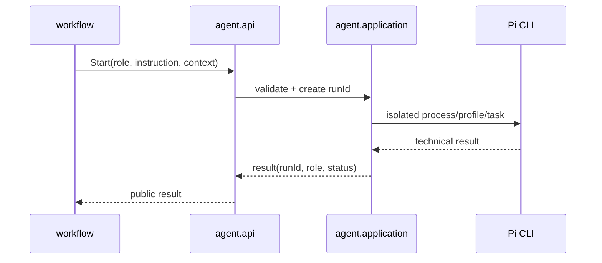

# Design

## Context

Pi запускается отдельным процессом, а Analyst/Architect/Developer/Reviewer являются параметрами инструкции. Каждый вызов должен иметь собственный контекст и не разделять mutable-состояние с другим запуском.

## Goals / Non-Goals

**Goals:** модель роли, профильные инструкции, per-run context и возврат результата. **Non-Goals:** оркестрация последовательности ролей, approval gates и workflow state.

## Decisions

### D1: Роль как значение
**Решение:** роль — enum/value с поддержанным идентификатором и опциональной ссылкой на профиль. **Почему:** роль является параметром запуска. **Альтернатива:** отдельные сервисы Analyst/Developer — нарушают границу agent.

### D2: Профили
**Решение:** на первом этапе профиль идентифицируется ссылкой/именем и разрешается адаптером из конфигурации или файла; содержимое не хранится в workflow. **Почему:** позволяет менять инструкции без Java-классов. **Альтернатива:** захардкодить prompt в сервисах — отклонена.

### D3: Контекст запуска
**Решение:** команда содержит immutable task input, context и workspace path, а application создаёт уникальный run id. **Почему:** данные одного запуска нельзя случайно переиспользовать.

### D4: Результат
**Решение:** каждый result содержит тот же run id и role metadata. Структурированный бизнес-результат не добавляется. **Почему:** agent возвращает технический текст; интерпретация принадлежит workflow.

### D5: Поток

## Risks / Trade-offs

- Файлы профилей требуют политики пути и версии; ссылка, а не содержимое, снижает размер команды.
- Полная изоляция может требовать уникальных временных ресурсов; это предпочтительнее общего mutable context.

## Open Questions

- Где окончательно хранить профили: конфигурация, workspace-файлы или каталог приложения.
- Нужен ли структурированный формат Pi result сверх текста и exit code.
