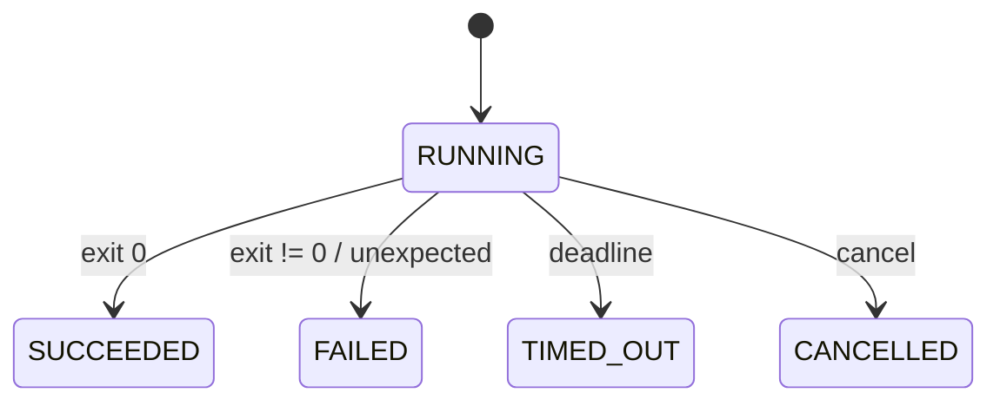

# Design

## Context

Pi может зависнуть, завершиться с ошибкой или быть отменён workflow. Lifecycle должен быть техническим и относиться к одному run, не управляя бизнес-состоянием процесса разработки.

## Goals / Non-Goals

**Goals:** timeout, cancellation, exit code mapping, status transitions и cleanup. **Non-Goals:** retries, workflow transitions, Temporal state и отказоустойчивость.

## Decisions

### D1: Timeout
**Решение:** timeout задаётся на команду или typed default и измеряется от начала subprocess до завершения. **Почему:** вызывающая сторона контролирует бюджет времени.

### D2: Отмена
**Решение:** сначала вызвать `process.destroy()`, дождаться завершения и при необходимости применить `destroyForcibly()`. **Почему:** даёт мягкое завершение и гарантирует освобождение. **Альтернатива:** только прервать Java-поток — не завершает Pi.

### D3: Статусы
**Решение:** `RUNNING`, `SUCCEEDED`, `FAILED`, `TIMED_OUT`, `CANCELLED`. **Почему:** различает причины технического завершения.

### D4: Ненулевой exit
**Решение:** любой ненулевой exit code даёт `FAILED`, code сохраняется, stdout/stderr доступны. **Почему:** exit code — наблюдаемая техническая причина.

### D5: Граница

## Risks / Trade-offs

- Принудительное завершение может оставить дочерние grandchildren; адаптер должен документировать границу process tree.
- Timeout/cancel требуют конкурентного контроля, но явные состояния упрощают проверку.

## Open Questions

- Нужно ли публиковать отдельное событие отмены или достаточно result.
- Точный grace period перед `destroyForcibly()`.
