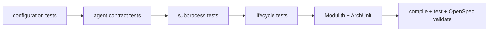

# Design

## Context

Тесты должны проверять agent без сети и без обязательной установки Pi. Подменяемый launcher или тестовый executable позволяет воспроизвести большие потоки, ошибки и задержки.

## Goals / Non-Goals

**Goals:** покрыть AG-25..AG-30 и архитектурные запреты. **Non-Goals:** тестирование workflow-переходов, Git, GitHub API и production observability.

## Decisions

### D1: Test process
**Решение:** использовать маленький test executable и подменяемый driven-port. **Почему:** детерминированно моделирует exit code, output, hang и signal. **Альтернатива:** запуск установленного Pi в каждом тесте — нестабилен и не обязателен.

### D2: Большой output
**Решение:** сценарий пишет объём больше pipe buffer одновременно в stdout и stderr. **Почему:** выявляет последовательное чтение.

### D3: Lifecycle assertions
**Решение:** проверять status, exit code, process termination и закрытие ресурсов после timeout/cancel.

### D4: Architecture
**Решение:** Spring Modulith verify плюс ArchUnit/проверка импортов подтверждают листовую границу и отсутствие workflow/Git/GitHub ответственности.

### D5: Verification flow

## Risks / Trade-offs

- Тестовый executable может вести себя иначе на ОС; driven-port сохраняет основной набор платформонезависимым.
- Архитектурная проверка импортов может быть хрупкой; её следует формулировать по пакетам и публичным границам.

## Open Questions

- Отдельный интеграционный профиль с установленным Pi может быть добавлен позже.
- Нужны ли property-based сценарии для аргументов со спецсимволами.
