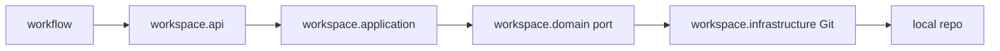

# Design

## Context

`workspace` — листовой модуль Spring Modulith; `workflow` должен зависеть только от его публичного API. Подробная мотивация приведена в `proposal.md`.

## Goals / Non-Goals

**Goals:** стабильные immutable-модели, порты API и Git, типизированные ошибки, изоляция слоёв.

**Non-Goals:** выполнение clone/update, ветки, блокировки и очистка.

## Decisions

### D1: Архитектура портов и адаптеров
**Решение:** публичные порты находятся в `workspace.api`, use case — в `workspace.application`, driven-порт Git — в `workspace.domain`, адаптер — в `workspace.infrastructure`. **Почему:** зависимости направлены внутрь, а `workflow` не видит инфраструктуру. **Альтернатива:** вызов Git из API отклонён из-за утечки деталей.

### D2: Git-механизм
**Решение:** JGit. **Почему:** чистая Java, отсутствие shell-инъекций и детерминированные тесты с `file://`. **Альтернатива:** CLI `git` допустим как запасной вариант, но требует управления процессами и окружением.

### D3: Модель ошибок
**Решение:** публичные категории ошибок отделяются от исключений адаптера. **Почему:** контракт стабилен при замене JGit/CLI. **Альтернатива:** экспорт исключений Git отклонён.

## Risks / Trade-offs

- JGit может отличаться от системного Git → тестировать требуемые операции на локальных репозиториях.
- Стабильный контракт может потребовать расширения → добавлять поля обратно совместимо.

## Open Questions

- Точные параметры lease и политика восстановления фиксируются в change 21.
