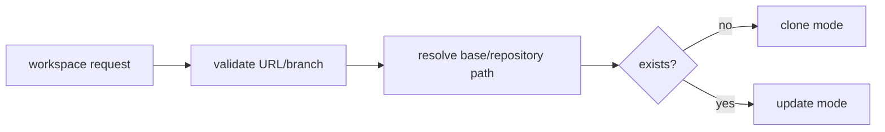

# Design

## Context

Change 17 определил контракт. Теперь нужно детерминированно выбрать одну общую копию репозитория и режим её подготовки до вызова Git.

## Goals / Non-Goals

**Goals:** конфигурация корня, безопасная нормализация входов, стабильный путь, различение clone/update.

**Non-Goals:** выполнение Git, ветки и lock lease.

## Decisions

### D1: Одна копия на репозиторий
**Решение:** путь вычисляется по репозиторию, а Workflow изолируется рабочей веткой; блокировка будет на уровне репозитория. **Почему:** экономит место и делает состояние единым. **Альтернатива:** копия на Workflow даёт изоляцию, но усложняет синхронизацию и расход диска.

### D2: Безопасный путь
**Решение:** нормализовать URL в стабильный идентификатор и проверять containment относительно base directory. **Почему:** исключает path traversal. **Альтернатива:** использовать URL как имя отклонено из-за `/`, `:` и неоднозначности.

### D3: Механизм Git
**Решение:** JGit; CLI `git` остаётся допустимой альтернативой. **Почему:** чистая Java и тесты с `file://`; нет shell-инъекций.

## Risks / Trade-offs

- URL normalization может объединить разные записи → сохранить исходный URL в метаданных и документировать canonicalization.
- Разделяемая копия требует lock → обязательная реализация в change 21.

## Open Questions

- TTL lease и stale-owner policy определяются в change 21.
