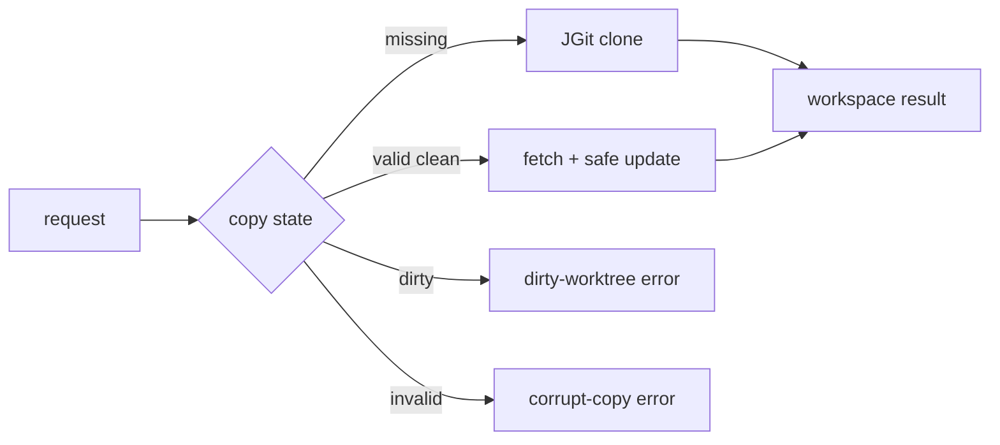

# Design

## Context

Changes 17–18 определили модели, путь и режим. Этот change выполняет подготовку общей копии; локальные изменения не должны теряться.

## Goals / Non-Goals

**Goals:** JGit clone/fetch, проверка состояния, безопасное обновление, диагностика повреждённых копий.

**Non-Goals:** создание Workflow-веток и распределённые блокировки.

## Decisions

### D1: JGit
**Решение:** использовать JGit через domain-порт. **Почему:** чистая Java, отсутствие shell-инъекций, локальные `file://`-репозитории для тестов. **Альтернатива:** CLI `git` допустим, но усложняет управление процессами.

### D2: Политика обновления
**Решение:** fetch и fast-forward/reset только при чистом дереве; dirty tree — ошибка. **Почему:** гарантирует отсутствие автоматической потери работы. **Альтернатива:** stash/reset отклонены как неявное изменение пользовательских данных.

### D3: Повреждённые копии
**Решение:** диагностировать и не удалять автоматически. **Почему:** сохранение данных и возможность ручного восстановления. **Альтернатива:** удалить/reclone отклонено.

## Risks / Trade-offs

- Fetch может пройти, а обновление завершиться конфликтом → возвращать Git error и сохранять копию.
- Общая копия требует lock вокруг операций → change 21 обязан оборачивать use case.

## Open Questions

- Способ восстановления stale lock фиксируется в change 21.
