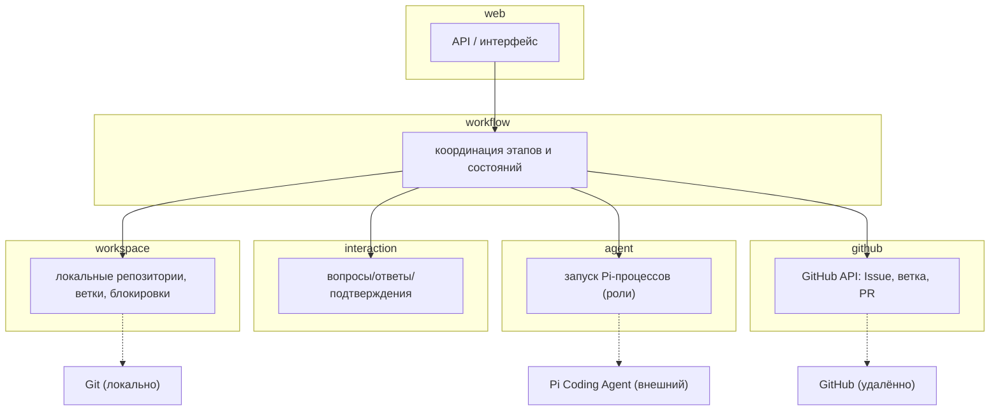

# Design

## Context

См. `proposal.md` — Why. Существует capability `development-workflow` (бизнес-процесс из этапов и состояний), но нет модульной архитектуры. Ограничения: Java + Spring Boot, Spring Modulith (модульный монолит), DDD, Temporal для долговременного исполнения, Pi Coding Agent для ролей, Git/GitHub. Бизнес-логика отделена от инфраструктуры; без нужды не вводятся лишние модули/абстракции.

## Goals / Non-Goals

**Goals:**
- Задать состав базовых модулей и их границы ответственности.
- Зафиксировать направление зависимостей и правила взаимодействия.
- Разделить доменную и инфраструктурную ответственность.
- Определить интеграцию Temporal, Pi, Git, GitHub через явные контракты.
- Сделать границы пригодными для проверки Spring Modulith.

**Non-Goals:**
- Не проектируются классы, контроллеры, репозитории, сущности и таблицы.
- Не реализуется бизнес-функциональность и не запускаются Pi-агенты.
- Распределение этапов между доменом и Temporal зафиксировано отдельным решением (см. D6) и не является окончательным по реализации.
- Не вводится отдельный `shared`/`common`/`artifacts` модуль без обоснования.

## Decisions

### D1: Шесть базовых модулей

Состав модулей: `workflow`, `workspace`, `agent`, `interaction`, `github`, `web`.

- **Почему**: каждый модуль соответствует самостоятельной связной ответственности (координация, локальный Git, запуск агентов, диалог с пользователем, GitHub API, интерфейс). Локальный Git и GitHub API разделены, так как это разные системы и жизненные циклы.
- **Альтернатива**: объединение `workspace`+`github` в один `vcs` — отклонено, так как локальные и удалённые операции имеют разные границы, данные и частоту изменений.

### D2: `workflow` — ядро координации, не владеет инфраструктурой

`workflow` владеет моделью процесса (этапы, состояния, переходы) и оркестрирует другие модули, но сам не выполняет Git, запуск Pi и вызовы GitHub API.

- **Почему**: отделяет бизнес-координацию от инфраструктуры; предотвращает разрастание `workflow` в god-module.
- **Альтернатива**: разместить всю интеграцию в `workflow` — отклонено (нарушает разделение ответственности).

### D3: Temporal интегрируется через application-слой модуля `workflow`

Temporal — технология долговременного исполнения; она подключается на уровне application-слоя `workflow`, а доменная модель процесса остаётся независимой от Temporal.

- **Почему**: инфраструктура не должна определять бизнес-модель.
- **Открытый момент**: точное распределение последовательности этапов между доменной моделью и Temporal Workflow не фиксируется (см. Open Questions).

### D4: Взаимодействие только через публичные контракты

Каждый модуль предоставляет публичный контракт, внутренности инкапсулированы; зависимости между модулями ацикличны.

- **Почему**: сохраняет модульность и делает границы проверяемыми.
- **Альтернатива**: свободный доступ к внутренним классам — отклонено (нарушает границы).

### D5: Web — тонкий интерфейсный слой

`web` принимает запросы от пользователя и делегирует бизнес-модулям; не содержит логики этапов и не запускает Pi напрямую.

- **Почему**: бизнес-правила сосредоточены в доменных модулях, web остаётся адаптером.
- **Альтернатива**: web с логикой этапов — отклонено (размазывает бизнес-правила).

### D6: Распределение этапов между доменной моделью и Temporal (ADR)

Доменная модель `workflow` владеет этапами и состояниями процесса (чистые перечисления/агрегаты без Temporal). Temporal Workflow в application-слое отвечает за оркестрацию выполнения: вызов активностей, ожидание пользователя и retry.

- **Почему**: отделяет бизнес-модель от инфраструктурного движка; домен остаётся тестируемым без Temporal.
- **Альтернатива**: жёсткая машина состояний в Temporal — отклонена, так как поведение должно быть проверяемым на уровне домена.

### D7: Форма публичных контрактов — port/adapter

Для внешних систем (`agent`, `workspace`, `github`) используются порты (интерфейсы на границе домена/приложения) и адаптеры (реализация в инфраструктуре). `web` — отдельный адаптер.

- **Почему**: инверсия зависимостей — домен зависит от порта, реализация от внешней системы поставляется адаптером.
- **Альтернатива**: прямые вызовы SDK — отклонены, так как связывают бизнес с инфраструктурой.

### D8: Синхронность вызовов workflow → agent/interaction

Вызовы `workflow` → `agent` и `workflow` → `interaction` выполняются асинхронно: Pi-запуски и ожидание пользователя — долгие операции, не блокирующие поток координации синхронно.

- **Почему**: долгие операции не должны удерживать синхронный поток; результат приходит по завершении.
- **Альтернатива**: синхронный вызов — отклонён из-за длительности Pi-запусков и ожидания пользователя.

## Диаграмма модулей и взаимодействий

Направление зависимостей: `web → workflow → {workspace, agent, interaction, github}`. Бизнес-модули не зависят от `web`; между собой нижние модули напрямую не общаются мимо `workflow` (кроме согласованных публичных контрактов, если понадобятся).

## Risks / Trade-offs

### R1: Открытый вопрос распределения этапов между доменом и Temporal

[Risk] Если распределение изменится, часть модуля `workflow` может переехать. → Mitigation: держим доменную модель процесса отделённой от Temporal через application-слой.

### R2: Риск чрезмерной декомпозиции

[Risk] Шесть модулей могут показаться избыточными на ранней стадии. → Mitigation: каждый модуль обоснован самостоятельной ответственностью; `shared`/`artifacts` не вводятся без нужды.

### R3: Связность `workflow` с нижними модулями

[Risk] `workflow` может стать точкой накопления хаба-логики. → Mitigation: он только координирует и не содержит реализацию интеграций.

## Open Questions

<!-- Все вопросы предыдущей ревизии закрыты решениями D6, D7, D8. Открытых вопросов нет. -->

## ADR: модульные границы (справочно)

| Модуль | Ответственность | НЕ делает | Владеет данными | Зависит от | Внешняя система |
|---|---|---|---|---|---|
| `workflow` | жизненный цикл, состояния, переходы, координация | Git, запуск Pi, GitHub API | состояние процесса, этапы | workspace, agent, interaction, github | — |
| `workspace` | локальные репозитории, ветки, Git-операции, блокировки | GitHub API | локальные пути, состояния веток, блокировки | — | Git (локально) |
| `agent` | запуск Pi-процессов, контекст, результаты | бизнес-правила workflow | сведения о запусках | — | Pi Coding Agent |
| `interaction` | вопросы/ответы/подтверждения пользователя | последовательность этапов | ожидающие решения | — | пользователь (через web) |
| `github` | GitHub API: Issue, публикация ветки, PR | локальные Git-операции | ссылки на Issue/PR | — | GitHub |
| `web` | API/интерфейс запуска и просмотра | бизнес-правила, запуск Pi | — | workflow (и бизнес-модули через контракты) | браузер/клиент |
