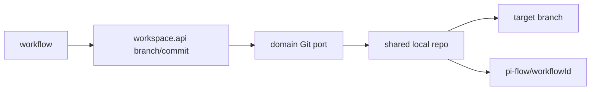

# Design

## Context

Подготовка из change 19 создаёт общую копию. Рабочая ветка должна изолировать Workflow, а Git остаётся внутренним адаптером workspace.

## Goals / Non-Goals

**Goals:** стабильное имя ветки, создание/checkout, проверка состояния, локальный commit-порт.

**Non-Goals:** push, Pull Request, GitHub API и бизнес-решения workflow.

## Decisions

### D1: Prefix ветки
**Решение:** `pi-flow/{workflowId}`. **Почему:** единый namespace явно принадлежит оркестратору и легко фильтруется. **Альтернатива:** `workflow/{workflowId}` короче, но менее специфичен.

### D2: Общая копия
**Решение:** одна копия на репозиторий, изоляция через ветки и lock. **Почему:** экономия диска при контролируемом последовательном доступе. **Альтернатива:** копия на Workflow отклонена как более тяжёлая.

### D3: Git-механизм
**Решение:** JGit; CLI допустим как альтернативный адаптер. **Почему:** чистая Java и тестируемость локальными репозиториями.

## Risks / Trade-offs

- Ветка может быть удалена вручную → возвращать типизированную Git-ошибку и не создавать её без явного сценария.
- Commit API может быть слишком узким → расширять только после потребностей workflow.

## Open Questions

- Push и публикация ветки остаются ответственностью `github` и workflow-интеграции.
