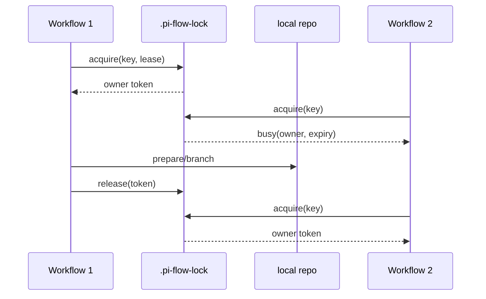

# Design

## Context

Changes 17–20 определили общую копию, подготовку и ветки. Для корректной последовательности нужен lock на уровне репозитория до всех изменяющих Git-операций.

## Goals / Non-Goals

**Goals:** файловый lock, owner/lease, атомарность, освобождение в success/failure, диагностика multi-instance.

**Non-Goals:** внешний distributed lock service, автоматическая очистка рабочих копий.

## Decisions

### D1: Файловая блокировка
**Решение:** lock-файл `.pi-flow-lock` в отдельном locks-каталоге с owner, creation time и expiry. **Почему:** работает в одном экземпляре и даёт диагностируемое поведение в нескольких экземплярах при общем filesystem. **Альтернатива:** JVM lock не защищает несколько процессов; Redis не нужен для локального оркестратора.

### D2: Атомарное создание и lease
**Решение:** эксклюзивное создание через filesystem atomic create, повторное чтение с проверкой expiry; владелец продлевает lease. **Почему:** предотвращает гонки. **Альтернатива:** lock без TTL оставляет вечные блокировки после crash.

### D3: Общая копия и cleanup
**Решение:** lock на repository key; рабочие директории не удалять автоматически. **Почему:** сохраняются данные и изоляция Workflow обеспечивается веткой. **Альтернатива:** cleanup после ошибки опасен для диагностики.

## Risks / Trade-offs

- Clock skew между экземплярами → хранить абсолютный expiry и использовать допустимый grace period.
- Crash оставляет lock до expiry → короткий, конфигурируемый lease и диагностика owner.

## Open Questions

- Точные значения lease/renewal interval можно выбрать в реализации при сохранении поведения spec.
