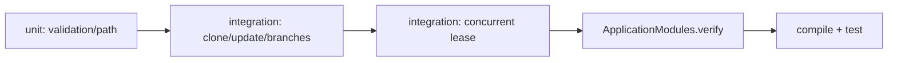

# Design

## Context

Это финальный change после 17–21. Тесты должны использовать локальные `file://`-репозитории и временные директории, не GitHub и не сеть.

## Goals / Non-Goals

**Goals:** пирамида unit/integration/architecture tests, детерминированная проверка JGit, конкуренция и lifecycle lock.

**Non-Goals:** нагрузочное тестирование внешних GitHub API и workflow-решений.

## Decisions

### D1: Тестовый Git
**Решение:** JGit и локальные bare/non-bare репозитории в temp directories. **Почему:** повторяемость и отсутствие сети/CLI. **Альтернатива:** системный git допустим только как отдельный adapter test.

### D2: Архитектурная проверка
**Решение:** `ApplicationModules.of(...).verify()` плюс проверки импортов API. **Почему:** подтверждает Modulith-границу и отсутствие циклов.

### D3: Конкуренция
**Решение:** два параллельных потока на один repository key и отдельные проверки release/recovery. **Почему:** проверяет observable lock semantics, а не только unit-мок.

## Risks / Trade-offs

- Временные тесты могут быть flaky на медленной FS → синхронизировать барьеры и использовать явные timeout.
- Architecture test зависит от пакетов → запускать на каждом изменении модульной структуры.

## Open Questions

- Точные тестовые реализации адаптеров можно выбрать без изменения контрактов.
