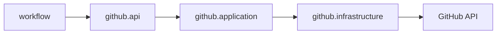

# Design

## Context

`github` — отдельный Spring Modulith-модуль проекта pi-flow; `workflow` может зависеть от него, но не от инфраструктуры. Последующие changes подключат REST-клиент и операции GitHub.

## Goals / Non-Goals

**Goals:** стабильные модели, узкие порты, application-оркестрация, границы Modulith. **Non-Goals:** HTTP-клиент, конфигурация, реальная пагинация и вызовы GitHub.

## Decisions

### D1: Контракт в `github.api`
**Решение:** разместить immutable-модели и отдельные порты репозиториев, Issues, публикации ветки и PR в `github.api`. **Почему:** потребитель не знает транспорт. **Альтернатива:** экспортировать HTTP DTO — отклонена из-за связанности.

### D2: Оркестрация через внутренний порт
**Решение:** application-слой реализует публичные порты и зависит от внутреннего порта адаптера. **Почему:** инверсия зависимостей и тестируемое делегирование. **Альтернатива:** вызывать REST из публичного сервиса — отклонена как нарушение границ.

### D3: Узкие операции
**Решение:** разделить чтение, публикацию ветки и PR. **Почему:** разные модели ошибок и ответственности. **Альтернатива:** единый `GithubService` — отклонена из-за широкой зависимости.

### D4: Границы Modulith
**Решение:** сохранить направление `workflow → github`, без обратной зависимости. **Почему:** соответствует `docs/architecture/module-responsibilities.md`. **Альтернатива:** общий модуль — не нужен.

### D5: Общий поток

## Risks / Trade-offs

- Слишком ранняя детализация моделей может потребовать расширения при REST-маппинге; риск снижается минимальным набором полей.
- Узкие порты требуют нескольких bean-инъекций, но делают зависимости проверяемыми.

## Open Questions

- Какие конкретные поля дополнительного описания Issue понадобятся потребителю; базовый контракт оставляет возможность расширения без HTTP DTO.
