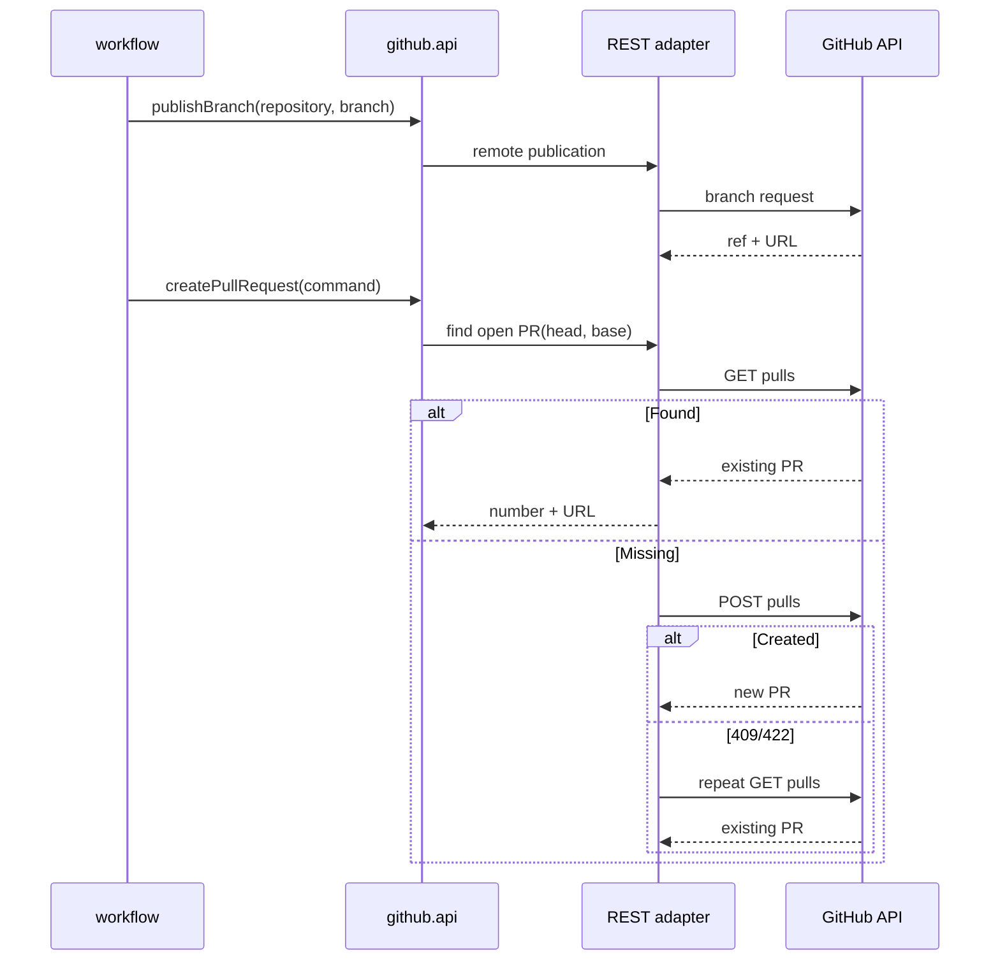

# Design

## Context

Публичные порты и модели определены в `github-module-contract`, подключение — в `github-api-connection`, чтение — в `github-repositories` и `github-issues`. Локальные ветки принадлежат `workspace`.

## Goals / Non-Goals

**Goals:** remote branch publication, валидация команды, поиск/создание PR и гонка. **Non-Goals:** локальный push, merge, review, webhook и изменение workflow state machine.

## Decisions

### D1: Публикация отделена от локального Git
**Решение:** API принимает ссылку/имя подготовленной ветки и выполняет только удалённую операцию. **Почему:** ответственность за локальный Git принадлежит workspace. **Альтернатива:** запуск `git push` из github — запрещён архитектурой.

### D2: Проверка PR перед POST
**Решение:** запрашивать открытые PR с head/base до создания. **Почему:** GitHub — источник истины для идемпотентности. **Альтернатива:** полагаться на состояние workflow — не защищает от повторного запуска.

### D3: Повторный поиск после конфликта
**Решение:** после 409/422 повторить поиск и вернуть найденный открытый PR. **Почему:** закрывает race между двумя исполнителями. **Альтернатива:** возвращать конфликт — оставляет пользователя без результата.

### D4: Поток создания

## Risks / Trade-offs

- Между поиском и POST остаётся короткое окно гонки; повторный поиск снижает риск дубликата.
- Семантика публикации ref зависит от поддержанного GitHub endpoint; контракт не разрешает подменять её локальным push.

## Open Questions

- Точная policy для ситуации только закрытого PR выбирается при реализации: новый PR или явная ошибка, но не возврат закрытого.
