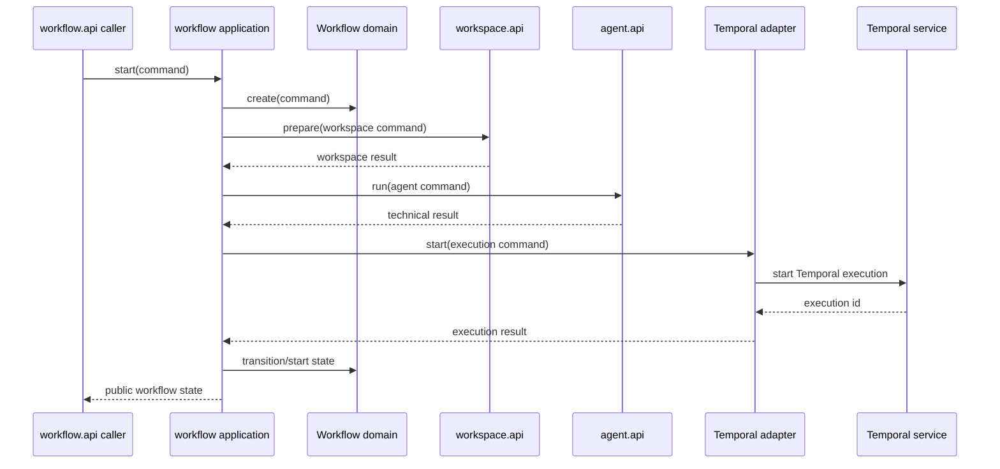

# Design

## Context

См. `proposal.md` и дельта-спецификации `workflow-lifecycle`, `workflow-temporal` и `workflow-runtime`. Проект использует Spring Modulith с пакетами `api/application/domain/infrastructure`; `workspace`, `agent` и `github` уже предоставляют публичные контракты, а `interaction` пока не содержит реализации. Docker-конфигурация и Temporal dependency отсутствуют.

## Goals / Non-Goals

**Goals:**

- Сделать `workflow` владельцем бизнес-состояния, этапов, переходов и контрольных точек.
- Запустить минимальный сценарий через публичные порты соседних модулей и отдельный Temporal adapter.
- Сохранить dependency inversion: домен знает только собственные модели и порты.
- Обеспечить проверяемый локальный runtime и архитектурные границы.

**Non-Goals:**

- Полная последовательность этапов разработки, review loops, approvals и AI decision logic.
- Реализация Git/JGit, Pi process runner, GitHub client или UI внутри workflow.
- Production deployment, HA Temporal cluster, внешняя persistence-модель Workflow и миграция существующих данных.

## Decisions

### D1. Доменный aggregate без фреймворков

Workflow будет обычной доменной моделью с value types для id/context, enum-типами статуса и этапа, коллекциями history/checkpoints и методом перехода, валидирующим state machine. Состояние должно быть сериализуемым через отдельные DTO/mapper на границе, но домен не будет аннотирован Spring, JPA или Temporal.

Альтернатива — Temporal workflow object как aggregate — отклонена: она связывает бизнес-правила с SDK и осложняет unit-тестирование.

### D2. Публичный API и application ports

`workflow.api` содержит команды, результаты, состояния, ошибки и операции запуска/чтения. Порт исполнения Temporal размещается на application boundary и принимает workflow-specific command/result, а не SDK-типы. Порты соседних модулей вызываются исключительно через их `*.api` контракты (`WorkspaceOperations`, `AgentOperations` и существующие GitHub contracts).

Альтернатива — прямой вызов Temporal из `workflow.api` или domain — отклонена из-за нарушения изоляции.

### D3. Оркестрация минимального сценария

Application service создаёт aggregate, выполняет валидацию, подготавливает workspace, передаёт техническую команду agent и вызывает execution port. Adapter в infrastructure преобразует команду в Temporal workflow/activity. Результат и ошибки преобразуются в публичные типы; infrastructure exceptions не экспортируются.

Последовательность:

Сбой подготовки workspace не запускает agent; failure Temporal не маскируется как успешный запуск. Идемпотентность запуска обеспечивается передачей заданного workflow id и явной обработкой duplicate/start errors, без введения новой persistence-модели в этом change.

### D4. Temporal SDK только в infrastructure

Temporal dependency и конфигурация ограничиваются `pom.xml`, infrastructure adapter/configuration и integration tests. Application port скрывает `WorkflowClient`, SDK options, stubs и activity interfaces. Task queue, namespace и endpoint задаются typed configuration с environment overrides.

Альтернатива — generic event bus или синхронный вызов вместо Temporal — отклонена, поскольку change явно требует Temporal и длительное исполнение.

### D5. Локальный Compose stack

Compose включает app, Temporal, PostgreSQL и Temporal UI; сервисы находятся в одной сети, app ожидает health/readiness Temporal, а Temporal использует PostgreSQL persistence. Dockerfile собирает приложение в multi-stage или эквивалентном воспроизводимом Java image, без включения секретов в образ.

Точные image tags и порты фиксируются в runtime documentation и проверяются smoke/integration запуском.

### D6. Проверки

Добавляются domain tests для каждой разрешённой/запрещённой transition, application tests с fake ports, Temporal integration test с локальным Test Server или Compose profile, а также ArchUnit/Spring Modulith tests. Architecture rules запрещают workflow domain/api зависимости от Temporal, Spring и infrastructure и сохраняют направление `workflow -> {workspace, agent, interaction, github}` без обратной зависимости.

## Risks / Trade-offs

- **[Risk]** Temporal SDK version может быть несовместима с Java 27 или Spring Boot 4.1.1 → **Mitigation:** зафиксировать совместимую версию dependency, выполнить Maven compile/test и отдельный integration test до закрытия задачи.
- **[Risk]** Локальный Compose стартует до готовности Temporal/PostgreSQL → **Mitigation:** healthchecks, dependency conditions и retry при подключении.
- **[Risk]** Минимальный сценарий может создать execution до получения полного технического результата → **Mitigation:** явно разделить accepted/running/failed состояния и документировать, что полная orchestration-семантика не входит в scope.
- **[Risk]** У workflow пока нет persistence adapter → **Mitigation:** не добавлять скрытую БД в этом change; состояние передавать через execution payload и зафиксировать ограничение в документации.
- **[Risk]** Публичные контракты соседних модулей могут не покрывать будущие этапы → **Mitigation:** использовать только существующие операции для минимального сценария и добавлять новые контракты отдельными capability changes.

## Migration Plan

1. Добавить dependency/configuration, domain и application ports, затем adapters и тесты.
2. Добавить Dockerfile/Compose и проверить запуск локального стека.
3. Включить workflow в существующие Modulith/ArchUnit проверки.
4. Rollback выполняется удалением workflow implementation, Temporal dependency/config и Docker artifacts; существующие модули не требуют миграции данных.

## Open Questions

- Нет вопросов, влияющих на текущие спецификации или план реализации. Выбор production persistence и полный каталог workflow stages остаётся отдельным изменением.
