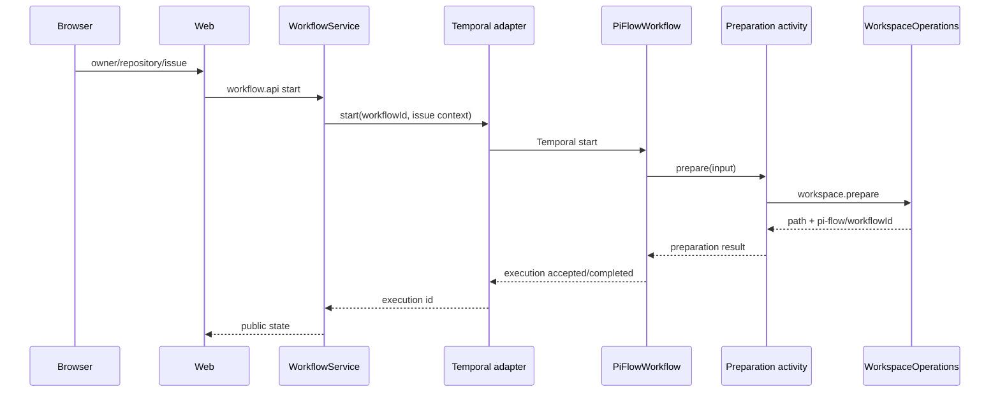

# Design

## Context

См. `proposal.md` и delta-спеки этого change. Текущий `WorkflowService` синхронно вызывает `workspace` и `agent` до `TemporalWorkflowAdapter`; `WorkflowPreparationActivitiesImpl` возвращает строку-заглушку. Web уже показывает Issues, workspace уже владеет JGit и принимает `WorkspacePreparationRequest`, а Temporal worker регистрирует preparation activity.

## Goals / Non-Goals

**Goals:**

- Сделать web Issue entry point тонким адаптером публичного `workflow.api`.
- Запускать Temporal execution с полным входом Issue и выполнять clone через activity.
- Повторно использовать `WorkspaceOperations.prepare`, включая существующую проверку пути, блокировки и Git-операции.
- Сохранить изоляцию домена/API от Temporal и направление `web → workflow → workspace`.
- Проверить локальный JGit clone, Temporal execution и Docker-based e2e.

**Non-Goals:**

- Изменение модуля `agent` или запуск Pi.
- Реализация новых GitHub, Git или workspace API.
- Продвижение Workflow по следующим стадиям после clone.
- Spring Shell entry point, production persistence или новая Temporal deployment topology.

## Decisions

### D1. Публичная команда сохраняет workflow id, но получает Issue-контекст

Web формирует owner/repository/issue number в команде запуска. URL репозитория вычисляется в application boundary по существующему GitHub URL-формату, а не в шаблоне и не в workspace. Домен хранит уже нормализованный `repositoryUrl` и `issueNumber`; owner/repository остаются входными transport/application данными.

Альтернатива — принимать только URL — отклонена, поскольку она не обеспечивает запуск по выбранной Issue. Форму Spring Shell не добавляем.

### D2. Temporal является границей для подготовки workspace

`WorkflowService.start` создаёт минимальное состояние и вызывает `WorkflowExecutionPort.start` с `WorkflowInput`. Temporal workflow вызывает activity, а реализация activity получает `WorkspaceOperations` через dependency injection и вызывает его с веткой `pi-flow/<workflowId>`. Application service не вызывает workspace synchronously и не вызывает agent.

Альтернатива — синхронный clone перед стартом Temporal — отклонена: она нарушает требование выполнения Git-операции внутри activity и усложняет retries/worker ownership.

### D3. Activity использует только публичный workspace контракт

Activity не импортирует JGit, не вычисляет clone path и не дублирует branch logic. Она строит `WorkspacePreparationRequest` с workflow id, repository URL, `pi-flow/<workflowId>` и placement parameters, затем переводит `WorkspaceException` в failure Temporal без маскировки ошибки как успешного результата.

### D4. Web запускается из списка Issues

Для каждой отображаемой `IssueSummary` добавляется ссылка/кнопка, ведущая на форму запуска с сохранёнными owner, repository и number. POST/submit контроллер валидирует ввод, вызывает `WorkflowOperations`, и возвращает view с результатом или сообщением об ошибке. Контроллер не обращается к `workflow.application`, `domain` или `infrastructure`.

### D5. Два уровня Temporal-проверки

Unit/integration activity test использует временный локальный bare/non-bare JGit repository и реальный `WorkspaceOperations` adapter. Temporal workflow test использует существующий `TestWorkflowEnvironment` для детерминированного worker execution. Отдельный e2e profile запускается против Temporal из Docker Compose и проверяет UI/public contract, созданную execution и фактическую рабочую ветку.

Тест с TestWorkflowEnvironment не заменяет Docker e2e; документация явно различает эти проверки.

### D6. Состояние запуска не продвигает доменную стадию

До будущих activity стадий workflow остаётся в существующей минимальной модели (`CREATED`/`RUNNING` по принятому контракту), а execution id фиксируется через уже существующий repository/state mapping. Результат clone не используется для запуска agent и не добавляет новый domain stage.

## Risks / Trade-offs

- **[Risk]** Temporal activity retry может повторно вызвать prepare для уже существующего рабочего каталога → **Mitigation:** использовать существующую идемпотентную семантику workspace и тестировать повторный вызов/занятую ветку; не удалять локальные изменения автоматически.
- **[Risk]** Docker e2e зависит от Docker, Temporal readiness и доступного Git-источника → **Mitigation:** отдельный явно помеченный e2e profile, health/readiness ожидание и локальный fixture repository.
- **[Risk]** Формат owner/repository URL может отличаться для GitHub Enterprise → **Mitigation:** в этом change зафиксировать существующий формат проекта и не расширять GitHub configuration scope.
- **[Risk]** Execution может быть принят до завершения activity → **Mitigation:** e2e ждёт activity completion/result и проверяет clone; публичный запуск отдельно проверяет только получение execution id.
- **[Risk]** Существующие тесты ожидают synchronous workspace/agent calls → **Mitigation:** обновить unit tests на отсутствие обоих вызовов и оставить agent module без изменений.

## Migration Plan

1. Добавить публичные поля/вход для Issue и web view action, сохранив существующие операции чтения Issues.
2. Перенести подготовку из service в Temporal activity и адаптировать workflow input/worker wiring.
3. Обновить unit, activity, architecture и TestWorkflowEnvironment tests.
4. Запустить Docker Temporal и выполнить отдельный e2e сценарий с локальным fixture repository.
5. Rollback: вернуть старую синхронную цепочку нельзя как целевое поведение; откат change удаляет новые web action/activity wiring, не меняя модуль `agent` и persistence данных.

## Open Questions

Нет открытых вопросов, влияющих на scope или критерии приёмки.
