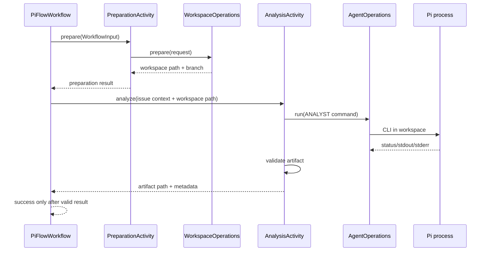

# Design

## Context

См. `proposal.md` и delta-спеки. Сейчас `PiFlowWorkflowImpl` вызывает только `WorkflowPreparationActivities.prepare`, а `WorkflowPreparationActivitiesImpl` использует публичный `WorkspaceOperations`. Публичный `agent.api` уже предоставляет `AgentOperations.run`, `StartAgentCommand`, роль `ANALYST` и `AgentRunResult`; `ProcessAgentRunner` передаёт задачу через stdin, задаёт рабочую директорию, собирает оба потока и поддерживает `FakePi` в тестах. Формат аналитического артефакта и activity анализа пока отсутствуют.

Проверка установленного Pi (v1.4.0) подтвердила: реальный CLI не имеет флагов `--role`/`--run-id` и не читает задачу как stdin-протокол. Для неинтерактивного запуска используются `--print`, системный промпт (`--system-prompt`/`--append-system-prompt`), файлы (`@path`), позиционные сообщения и piped stdin (дописывается в начало первого промпта); exit code ненулевой при ошибке/abort/обрезке по лимиту токенов.

## Goals / Non-Goals

**Goals:**

- Добавить минимальную последовательность Temporal `prepare → analyze`.
- Оставить запуск процессов и Git-операции вне workflow-кода.
- Сохранить модульные границы: workflow вызывает только `workspace.api` и `agent.api`, agent не знает Temporal.
- Сохранить большой результат анализа в workspace, а через Temporal возвращать путь и метаданные.
- Сделать результат и повторные вызовы проверяемыми и безопасными.
- Задать описание роли Analyst через ресурсные файлы `src/main/resources/roles/analyst/` (системный промпт и скилы), на первом этапе — упрощённые описания.
- Перевести запуск Pi на подтверждённый CLI-контракт (`--print`, `--append-system-prompt`, `@path`/сообщения, exit code).

**Non-Goals:**

- Реализация Architect, Developer, Reviewer, QA, approvals, UI или новой persistence-системы.
- Генерация OpenSpec Proposal агентом Analyst.
- Изменение доменной модели workflow без прямой необходимости для интеграции.
- Универсальная orchestration framework или новый транспорт Pi.

## Decisions

### D1. Отдельная activity анализа

Добавить отдельный сериализуемый вход analysis activity, содержащий workflow id, Issue context и путь workspace, и отдельный результат, содержащий путь артефакта, статус и технические метаданные. Workflow создаёт activity stub с существующей политикой timeout/retry, вызывает preparation, затем analysis; workflow не вызывает `AgentOperations` напрямую.

Альтернатива — запускать агента в `PiFlowWorkflowImpl` — отклонена, поскольку workflow-код должен быть детерминированным и не владеть операционными процессами.

### D2. Делегирование публичному AgentOperations

Implementation activity получает `AgentOperations` через существующее DI/wiring и формирует `StartAgentCommand` с `AgentRole.ANALYST`, явной инструкцией, Issue input/context, `Path` из preparation result и параметром ожидаемого артефакта. Описание роли не вшивается текстом в команду — путь к роль-ресурсам (`system-prompt.md` и `skills/`) резолвится по роли (см. D7). Инфраструктурные типы agent и process runner не импортируются workflow.

Альтернатива — расширить agent отдельным методом `analyze` — отклонена: роль уже является параметром существующего контракта.

### D3. Артефакт в workspace

Использовать один детерминированный путь внутри подготовленного workspace, например `.pi-flow/analysis/analyst.md`, создавая нужные родительские каталоги только в пределах workspace. Агенту явно поручается записать анализ в этот файл; activity после возврата проверяет regular file, readability и непустое содержимое. Результат Temporal возвращает путь, размер/контрольные метаданные и run id, но не весь текст.

Если существующая конфигурация профиля Analyst задаёт другой подтверждённый формат, implementation SHALL переиспользовать его вместо параллельного контракта; изменение фиксируется до реализации в тестах и design update.

### D4. Проверка результата AgentRunResult

Activity считает запуск успешным только при `SUCCEEDED`, exit code `0` (если присутствует) и валидном артефакте. `FAILED`, `TIMED_OUT`, `CANCELLED`, launch/execution/result exception, отсутствующий файл, unreadable file или blank content превращаются в activity failure. Stdout не считается артефактом автоматически: это предотвращает ложный успех, когда Pi завершился без сохранения результата.

### D5. Идемпотентность и retries

Путь артефакта зависит только от workflow и workspace. Activity не удаляет workspace и не делает destructive cleanup. Перед запуском повторного вызова проверяется существующий собственный артефакт; реализация выбирает безопасную политику overwrite только для этого явно выделенного файла, не затрагивая остальные файлы. Temporal retry используется через текущие activity options, без новой retry-инфраструктуры.

### D6. Подтверждённый CLI-контракт Pi

Установленный Pi (v1.4.0) проверен: реальный CLI не имеет флагов `--role`/`--run-id` и не трактует stdin как протокол задачи. Одноразовый запуск выполняется через `--print` (final text в stdout, ненулевой exit code при ошибке/abort/обрезке по лимиту). Роль/инструкция передаются через `--append-system-prompt <file>` (повторяемый) и первый промпт, контекст-файлы — через `@path` или позиционные сообщения. `ProcessAgentRunner` переводится на этот контракт; порт `AgentProcessRunner` и тестируемость fake-процессом сохраняются, `FakePi` обновляется под реальные аргументы. Текущие `--role`/`--run-id`/`--key=value` и stdin-payload удаляются.

### D7. Роль-ресурсы Analyst в resources

Описание роли Analyst хранится в ресурсах, а не вшивается в код или конфигурацию профиля: `src/main/resources/roles/analyst/system-prompt.md` (системный промпт) и `src/main/resources/roles/analyst/skills/` (скилы с `SKILL.md`, при необходимости `references/`). При запуске Pi для `ANALYST` runner передаёт системный промпт через `--append-system-prompt <file>`, а скилы — через `--skill <dir>`. На первом этапе кладём упрощённые описания: краткий промпт «что такое Analyst и что он должен выдать» и один скил, фиксирующий формат артефакта анализа. Пути резолвятся относительно classpath/resources, чтобы работать и из jar, и из рабочего дерева.

### D8. Резолв базовой ветки workspace

Подготовка workspace должна работать с реальными репозиториями, где дефолтная ветка — `main`, а не `master`. Базовую ветку резолвит модуль `workspace` (через `LocalGit.resolveBaseBranch`): предпочтительная ветка (`master`), если она есть в удалённом репозитории, иначе `main`. Резолв выполняется один раз в начале `WorkspaceService.prepare` и используется консистентно для clone/update и создания ветки `pi-flow/<workflowId>`, чтобы не рассинхронизировать клонированную базовую ветку и точку создания рабочей ветки.

## Risks / Trade-offs

- **[Risk]** Переход runner на реальный CLI может сломать совместимость с `FakePi` → **Mitigation:** обновить `FakePi` под подтверждённые аргументы и сохранить порт `AgentProcessRunner` неизменным.
- **[Risk]** Агент может записать артефакт в иной путь или только вывести текст → **Mitigation:** передавать детерминированный путь в инструкции и отклонять отсутствие файла.
- **[Risk]** Temporal retry может повторно запустить Analyst и перезаписать анализ → **Mitigation:** детерминированный собственный путь, отсутствие destructive cleanup, тест повторного вызова и проверка содержимого перед/после.
- **[Risk]** Большой анализ может попасть в stdout или history → **Mitigation:** возвращать только путь/метаданные и не помещать полный текст в workflow result.
- **[Risk]** Неверно настроенный agent может скрыть ошибку через статус success → **Mitigation:** проверять exit code и файл независимо от stdout.

## Migration Plan

1. Создать роль-ресурсы Analyst (`src/main/resources/roles/analyst/system-prompt.md` и `roles/analyst/skills/`) с упрощёнными описаниями.
2. Добавить модели и контракт analysis activity, затем unit-тесты с mock `AgentOperations` и временным workspace.
3. Зарегистрировать activity в существующем Temporal worker wiring и изменить workflow на последовательный вызов.
4. Расширить Temporal integration-тесты успешным и отказными сценариями.
5. Перевести `ProcessAgentRunner` на подтверждённый CLI-контракт (`--print`, `--append-system-prompt`, `@path`/сообщения, exit code) и обновить `FakePi` под реальные аргументы; проверить существующие process-runner тесты.
6. Выполнить compile/test/OpenSpec validation и зафиксировать фактические результаты.
7. Rollback: удалить analysis activity wiring и вернуть workflow к завершению после preparation; существующие workspace и agent API не требуют миграции данных.

## Open Questions

Нет вопросов, меняющих выбранный scope или контракт. CLI-контракт Pi (v1.4.0) подтверждён: `--print`, `--append-system-prompt`, `@path`/сообщения, exit code. Открытым остаётся наполнение роль-ресурсов Analyst: на первом этапе оно упрощённое и уточняется последующими этапами.
