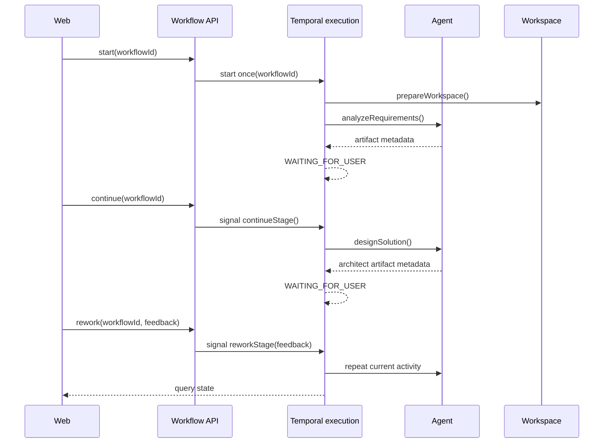

# Design

## Context

См. `proposal.md` и delta-спеки. Сейчас `TemporalWorkflowAdapter.start` создаёт новый уникальный execution для каждого `WorkflowExecutionKind`, `PiFlowWorkflowImpl` завершается после preparation+Analyst, а Architect запускается отдельно. `WorkflowService` получает результат через `getResult` с timeout и переносит текст артефакта в in-memory domain. Domain уже содержит `WAITING_FOR_USER`, `continueAfterAnalysis()` и `rework()`, но их нужно связать с сигналами одного durable execution. Источником истины для больших артефактов остаётся workspace.

## Goals / Non-Goals

**Goals:**

- Один стабильный Temporal workflow id на весь пользовательский flow.
- Durable sequential orchestration с сигналами, query и ручными gates после Analyst и Architect.
- Имена этапов и activities, однозначно связывающие роль и действие.
- Сохранение текущих artifact checks и модульных границ.

**Non-Goals:**

- Полная реализация Developer/Reviewer, pull request, approval beyond defined gates или OpenSpec Proposal generation.
- Новая БД и устранение существующего ограничения in-memory repository.
- Передача полного текста `analyst.md`/`architect.md` через Temporal history.

## Decisions

### D1. Один workflow contract вместо stage-specific contracts

Ввести единый Temporal interface с workflow method `run(WorkflowInput)`, signal methods `continueStage()` и `reworkStage(String feedback)`, а также query `state()`. Workflow id равен business workflow id и больше не содержит kind/UUID. Adapter получает typed stub по этому id; start выполняется один раз.

Альтернатива — оставить два workflow contract и связывать их parent/child executions — отклонена: это не удовлетворяет требованию одного execution и усложняет единый query state.

### D2. Событийная модель состояния внутри workflow

Реализация хранит только сериализуемое компактное состояние: stage, status, artifact paths, branch name, run ids, failure reason и pending command. Сигнал записывает pending command и feedback, а основной метод использует `Workflow.await` в ручном gate. После успешной activity state обновляется до `WAITING_FOR_USER`; сигнал атомарно выбирается только для текущего gate.

Большой текст не хранится в workflow state/history: query возвращает пути и метаданные, а application читает полный артефакт через workspace port при построении публичного состояния.

### D3. Имена этапов и activity

Стабильные технические имена: `ANALYST_ANALYZE_REQUIREMENTS`, `ARCHITECT_DESIGN_SOLUTION`, `DEVELOPER_IMPLEMENT_SOLUTION`, `REVIEWER_REVIEW_IMPLEMENTATION`. Соответствующие activities называются `prepareWorkspace`, `analyzeRequirements`, `designSolution`, `implementSolution`, `reviewImplementation`. Domain enum может сохранить обратимые значения `ANALYZING_REQUIREMENTS`, `DESIGNING_SOLUTION`, `IMPLEMENTING`, `REVIEWING`, `READY_FOR_PULL_REQUEST`; публичный mapper добавляет role/action label, поэтому переименование enum не требуется.

### D4. Ручные gates и scope этапов

После Analyst и Architect workflow вызывает `await` и принимает `continue`/`rework`. `continue` завершает текущий stage и начинает следующий. `rework` вызывает ту же activity с feedback и заменяет текущий результат. Developer/Reviewer перечислены в состоянии и transition map, но их activities не запускаются до отдельного change; после Architect continue workflow фиксирует `IMPLEMENTING` как явно неподдержанный следующий этап и не маскирует его как завершённый.

Это предотвращает ложное утверждение, что весь flow реализован, и позволяет отдельным proposals добавить автоматические или ручные правила для этих ролей.

### D5. Application adapter и web

`WorkflowExecutionPort` получает операции `start`, `queryState`, `continueStage`, `reworkStage`. `WorkflowService` создаёт домен один раз, прикрепляет тот же workflow id, а команды только сигнализируют Temporal; локальный домен синхронизируется по query. Web сохраняет текущие endpoints и workflow id, но больше не запускает Architect execution и не использует polling `getResult`.

### D6. Idempotency, concurrency и retries

Start использует `WorkflowOptions` с workflow id и конфликт при повторном start переводится в application validation/conflict. Signals проверяют stage/status внутри workflow; повторный signal после принятия не должен запускать activity дважды. Activity retry остаётся на Temporal retry policy, а успешный activity result должен быть идемпотентным для повторного вызова.

### D7. Artifact validation

Preparation возвращает workspace path. Analyst проверяет `analyst.md` и `branch.txt`; Architect проверяет `design/architect.md`. Результат содержит workspace path, artifact path/size, branch/run metadata. Полный текст читается `WorkspaceOperations` только для публичного read model и не входит в signal payload или query state.

## Interaction

## Risks / Trade-offs

- **[Risk]** In-memory domain state теряется при рестарте приложения, хотя Temporal execution durable → **Mitigation:** query Temporal при восстановлении/чтении и не заявлять persistence как часть change; новая БД не входит в scope.
- **[Risk]** Длинная history может расти при множественных rework → **Mitigation:** передавать только компактные metadata/feedback с измеримым лимитом и предусмотреть Temporal continue-as-new только как последующую оптимизацию, если она сохранит стабильный workflow id/query semantics.
- **[Risk]** Signal может прийти одновременно с завершением activity → **Mitigation:** принимать signal только после установления `WAITING_FOR_USER`, хранить pending command и проверять ожидаемый stage.
- **[Risk]** Developer/Reviewer ещё не выполняются → **Mitigation:** query явно показывает unsupported stage/transition и UI не выдаёт ложный `COMPLETED`.
- **[Risk]** Query зависит от доступности Temporal → **Mitigation:** возвращать типизированную ошибку, не использовать устаревшее локальное состояние как успешное.

## Migration Plan

1. Расширить application port/API и domain read model для стабильного workflow id, action labels и signal operations.
2. Заменить Temporal interfaces/adapter на единый workflow, сохранить preparation/Analyst/Architect activity validation и добавить query/signal handlers.
3. Перенести `WorkflowService` с `getResult`/stage execution polling на start/query/signal orchestration.
4. Обновить controller/template, role/action labels и тесты domain, adapter, Temporal integration, MVC и architecture boundaries.
5. Запустить Maven tests и `openspec validate`.

Rollback: вернуть старые stage-specific adapter/workflow contracts только до включения нового workflow id для окружения; уже созданные long-running executions должны завершаться через совместимый legacy read path либо быть явно остановлены, поэтому rollout требует feature flag/queue isolation на deployment уровне.

## Open Questions

Нет вопросов, меняющих scope, поведение или task breakdown.
