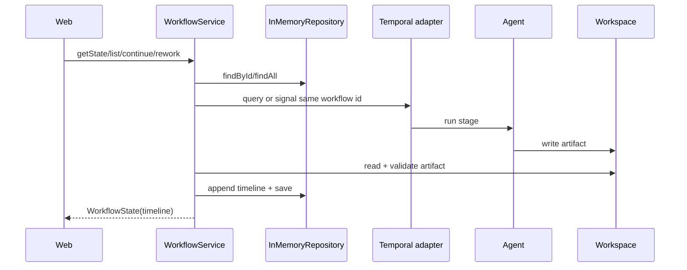

# Design

## Context

Сейчас `Workflow` хранит `completedStages` как имена и отдельные поля текущих `analysisText`/`designText`; `WorkflowState` поэтому не может восстановить историю после очистки результата. `WorkflowService` синхронизирует один Temporal execution через query, а web зависит только от `workflow.api`. Репозиторий in-memory умеет только `save` и `findById`. Architect пишет `.pi-flow/design/architect.md`, который проверяется только на непустой файл.

## Goals / Non-Goals

**Goals:**

- Ввести API-нейтральную модель записи timeline без зависимости domain/api от Temporal или Spring.
- Сохранить один длительный execution и фиксировать каждый результат как отдельную версию шага.
- Добавить список workflow через существующий workflow-порт и web-адаптер.
- Представлять Architect result единым Markdown proposal с проверяемыми заголовками.

**Non-Goals:**

- Не добавлять базу данных, внешнее хранилище или восстановление после рестарта.
- Не менять на отдельные Temporal workflows этапов и не реализовывать новые стадии Implementing/Reviewing.
- Не превращать timeline в редактируемый журнал и не добавлять удаление/архивирование workflow.

## Decisions

### D1. Отдельная неизменяемая запись завершённого шага

В domain вводится value object `CompletedWorkflowStep` с полями `stage`, `role`, `action`, `result`/artifact reference, `completedAt` и `runId`. `Workflow` хранит append-only список и публикует неизменяемую копию. Текущий результат остаётся transient/actionable частью агрегата до Continue/Rework, после чего копируется в timeline.

Альтернатива — расширить `Checkpoint`; она отклонена, потому что checkpoint сейчас смешивает технические события и пользовательские результаты и не имеет stage/role/runId.

### D2. Run identity из execution state

Temporal query/activities возвращают runId для фактического запуска этапа; application передаёт его при `recordAnalysis`/`recordDesign`. Для preparation также создаётся timeline-запись после валидного результата подготовки. Если старый execution не предоставляет runId, адаптер использует детерминированный fallback для совместимости, не меняя workflow id.

### D3. Расширение публичного workflow API

`WorkflowState` получает список timeline entries, а `WorkflowOperations` — `listWorkflows()`, возвращающий компактные summary DTO. `WorkflowRepository` получает `findAll` (или `list`) и in-memory adapter возвращает снимок значений. Web controller добавляет GET `/workflows` и рендерит `workflow-list`; track использует entries и не читает domain.

Альтернатива — отдельный web-only registry; отклонена, потому что дублирует источник истины и нарушает границу web → workflow.api.

### D4. Строгий proposal parser/validator

Workspace сохраняет путь `.pi-flow/design/architect.md`, но `readDesignArtifact` проверяет обязательные Markdown headings: `## Why`, `## What Changes`, `## Capabilities`, `## Impact`, `## Non-goals`, включая непустое содержимое до следующего heading/конца файла. Проверка остаётся в workspace/application contract; workflow только координирует чтение и запись результата.

### D5. Timeline rendering и actionable gate

Thymeleaf выводит `state.timeline` циклом в хронологическом порядке. Исторические записи — read-only; действия Continue/Rework рендерятся ровно один раз рядом с актуальным результатом при `WAITING_FOR_USER`. Для Architect Continue/Rework используются те же публичные операции и тот же workflow id.

### D6. Границы и поток данных

### D7. Совместимость перехода

Существующие статусы и stage enum сохраняются. `completedStages` либо вычисляется из timeline для обратной совместимости, либо остаётся deprecated projection; новые consumers используют timeline. Старые результаты, уже представленные отдельными полями, маппятся в записи timeline при первом чтении/синхронизации только если они ещё не записаны, чтобы не создавать дубликаты.

## Risks / Trade-offs

- **[Risk]** In-memory список теряется при рестарте → **Mitigation:** явно показать ограничение в design/API документации и не обещать durable history.
- **[Risk]** Неполный runId от Temporal приведёт к неуникальным записям → **Mitigation:** генерировать уникальный идентификатор итерации в adapter/application и покрыть повторный этап тестом.
- **[Risk]** Строгая проверка heading может отклонить старые architect.md → **Mitigation:** изменение применяется к новым запускам; ошибка отображается как failed result, без публикации невалидного proposal.
- **[Risk]** Большая timeline увеличивает HTML и память → **Mitigation:** хранить только текст уже завершённых этапов в рамках in-memory scope; pagination/сжатие не входят в этот change.
- **[Risk]** Continue может быть отправлен дважды → **Mitigation:** сохранить существующую доменную проверку ручного gate и сделать действия недоступными для исторических блоков.

## Migration Plan

Новых миграций данных нет: хранилище in-memory создаётся пустым при запуске. Реализация вводит DTO/API и шаблон обратно совместимо для новых состояний; при переходном чтении legacy полей создаются timeline entries без изменения Temporal workflow id. Rollback удаляет новые endpoints/UI и возвращается к текущим полям состояния; proposal-артефакты старого формата должны считаться невалидными только после включения новой валидации.

## Open Questions

Нет: формат обязательных разделов, endpoint списка, in-memory ограничение и поведение timeline определены спецификациями.
