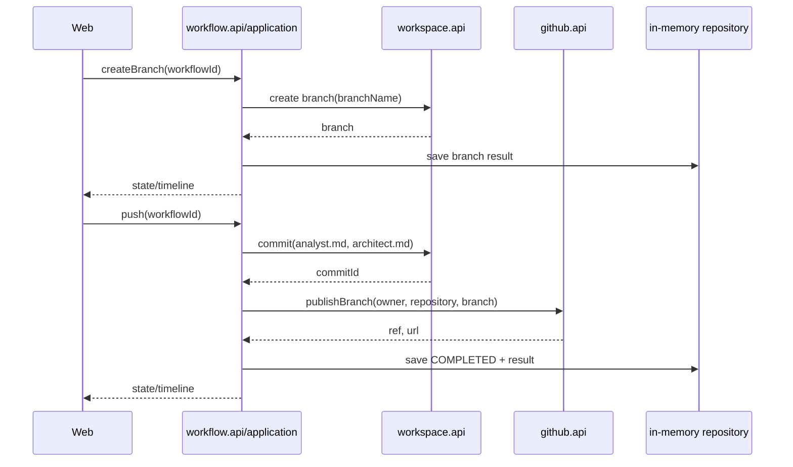

# Design

## Context

См. `proposal.md` для мотивации. Сейчас `WorkspaceGitOperations` умеет коммитить, но `WorkspacePreparationRequest` и подготовка создают техническую ветку `pi-flow/<workflowId>`. `BranchOperations` уже публикует имя ветки в GitHub, однако `WorkflowOperations` не координирует ни создание итоговой ветки, ни commit/publish. Длинный Temporal execution после Architect gate фактически останавливается на `IMPLEMENTING`; публичное состояние должно описать операции завершения и их результаты.

## Goals / Non-Goals

**Goals:**

- Сохранить один длительный workflow и существующие границы `web → workflow.api`, `workflow → workspace/github`, Temporal только в infrastructure.
- Сделать создание итоговой ветки, локальный commit двух артефактов и публикацию отдельными проверяемыми пользовательскими действиями.
- Сохранить результаты и ошибки в публичном состоянии/timeline с безопасными сообщениями.
- Обеспечить повторное чтение состояния и запрет повторного успешного push в пределах текущего in-memory процесса.

**Non-Goals:**

- Не создавать Pull Request и не менять существующий PR-контракт.
- Не добавлять approval, Developer, Reviewer или реализацию стадий `IMPLEMENTING`/`REVIEWING`.
- Не добавлять постоянное хранилище, миграции или восстановление состояния после рестарта.

## Decisions

### D1. Application-команды поверх одного execution

В `workflow.api` добавляются типизированные команды/операции создания ветки и push. `WorkflowService` проверяет состояние домена, получает workspace context, вызывает порты и сохраняет результат. Эти действия не запускают новый Temporal execution и не раскрывают Temporal web-контракту.

Рассмотренная альтернатива — новые Temporal signals `createBranch`/`push`. Она отклонена для Git-операций, потому что текущий execution уже находится на gate, а пользовательские операции должны быть синхронными application-сценариями с явным результатом; Temporal остаётся координатором длительных Analyst/Architect activity.

### D2. Разделение подготовки и итоговой ветки

Подготовка продолжает создавать изолированную техническую ветку `pi-flow/<workflowId>`, чтобы Analyst и Architect имели рабочее пространство. Команда «Создать ветку» вызывает workspace-операцию с последним валидным `branchName` и переключает ту же рабочую копию на итоговую ветку. Техническое имя не используется как результат Analyst.

Если публичного метода создания ветки недостаточно, расширяется `WorkspaceGitOperations` сериализуемой командой с workflow id, repository URL, target branch и параметрами текущего workspace; внутренний адаптер сохраняет lock/изоляцию.

### D3. Push как последовательность workspace → github

Push выполняется строго последовательно:

1. workspace коммитит только `.pi-flow/analysis/analyst.md` и `.pi-flow/design/architect.md`;
2. github публикует ту же ветку через `BranchOperations.publishBranch`;
3. workflow записывает commit id, ref/url и переводит состояние в `COMPLETED`.

При ошибке commit публикация не вызывается. При ошибке публикации commit не откатывается, но workflow становится `FAILED` с безопасным сообщением; повторный push допускается только явной политикой retry и не должен создавать второй успешный timeline result.

### D4. Явная модель состояния завершения

Домен получает состояния/метаданные для `branchCreated`, `commitId` и `branchUrl` либо эквивалентные timeline entries. `createBranch` разрешён только после успешного Architect gate. `push` разрешён только после создания ветки и при наличии обоих артефактов. Успех push — `COMPLETED`; ошибка любого шага — `FAILED` и безопасное `errorMessage` без exception class, stack trace или credentials.

### D5. Идемпотентность пользовательских действий

Двойное нажатие create branch повторно выбирает существующую ветку без дубликата. Двойное нажатие push после `COMPLETED` отклоняется как недопустимый переход и не вызывает commit/publish. Состояние блокируется существующим workflow lock и проверками домена/application.

### D6. Web-адаптер

`WorkflowController` добавляет POST-действия, которые принимают только workflow id, преобразуют `WorkflowException` в безопасное сообщение и возвращают status page. Шаблон показывает кнопки только для допустимого состояния и выводит результаты из публичного `WorkflowState`; web не обращается к workspace/github напрямую.

## Risks / Trade-offs

- **[Risk]** Техническая и итоговая ветки могут расходиться → **Mitigation:** создать итоговую ветку от актуального подготовленного workspace и коммитить только после явного действия пользователя.
- **[Risk]** Публикация может упасть после локального commit → **Mitigation:** сохранить commit id в ошибочном состоянии и обеспечить явную диагностику без stack trace; retry policy фиксируется тестами как отсутствие дубликата успешного результата.
- **[Risk]** В старом состоянии отсутствует путь к workspace после рестарта → **Mitigation:** in-memory ограничение явно документируется; операции доступны только живому workflow с актуальным workspace context.
- **[Risk]** Путь артефакта может быть изменён агентом → **Mitigation:** перед commit проверять фиксированный allowlist двух относительных путей и отклонять недоступные/пустые файлы.
- **[Risk]** Temporal query и application state могут временно расходиться → **Mitigation:** действия разрешаются по синхронизированному публичному state и сохраняются атомарно после результата порта.

## Migration Plan

Миграций данных нет. Реализация расширяет публичные Java API и шаблон, не меняя существующую подготовку технической ветки. Для новых workflow доступен полный завершающий flow; старые in-memory экземпляры не восстанавливаются. При rollback удаляются новые команды/кнопки и возвращается поведение остановки после Architect gate.

## Open Questions

Нет: конечное состояние `COMPLETED`, имена артефактов, порядок workspace→GitHub и non-goals определены этим change.
