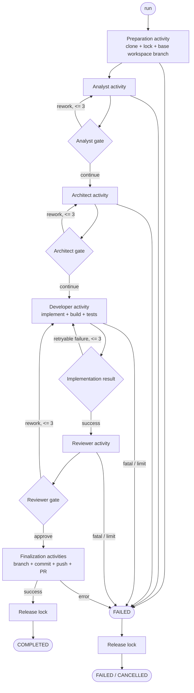

# Design

## Context

См. `proposal.md` — Why. Текущее Temporal workflow содержит preparation, Analyst gate и Architect gate. `WorkflowService` выполняет branch/push синхронно, а домен уже содержит этапы `IMPLEMENTING` и `REVIEWING`, но не имеет исполнителей и данных для PR. Публичные порты `agent`, `workspace` и `github` должны оставаться границами модулей; домен не должен зависеть от Temporal или Spring.

## Goals / Non-Goals

**Goals:**

- Провести один Temporal execution через implementation, review и finalization.
- Сохранить ручные gates через signals и сделать состояние домена наблюдаемым и согласованным с execution.
- Подключить DEVELOPER, REVIEWER и `PullRequestOperations` через существующие публичные контракты.
- Гарантировать лимит в 3 итерации, классификацию ошибок и освобождение lock во всех terminal states.

**Non-Goals:**

- Не создавать новые модули или заменять Temporal другим оркестратором.
- Не добавлять новый UI-протокол, если существующие команды continue/rework могут выразить gate.
- Не менять формат уже утверждённых Analyst и Architect artifacts без необходимости совместимости.

## Decisions

### D1. Один execution с activity boundaries

`PiFlowWorkflowImpl` остаётся единым long-running workflow. В него добавляются отдельные activity contracts для Developer, Reviewer и finalization. Локальные Git, GitHub API и subprocess не вызываются из workflow-кода или домена. Альтернатива — оставить branch/push в `WorkflowService`; отклонена, поскольку она уже создаёт рассогласование execution и домена.

### D2. Сигналы для всех пользовательских gates

`continueStage` и `reworkStage(feedback)` остаются сигналами того же execution; workflow хранит только сериализуемое состояние ожидания. Architect approval запускает implementation, Reviewer approval запускает finalization, а Reviewer rework возвращает execution к Developer. Для однозначной маршрутизации сигналов добавляется ожидаемый gate/stage и валидация command против него.

### D3. Данные результата в activity boundary

Developer activity возвращает workspace path, run id, статус и диагностические сведения о build/test. Reviewer activity возвращает run id и artifact/result ревью. Finalization возвращает commit id, branch URL, PR number и PR URL. Timeline и публичное состояние обновляются через application/domain orchestration, а не через Temporal типы.

### D4. Счётчики rework и классификация ошибок

Домен хранит счётчики итераций implementation/review и применяет максимум 3 к каждому циклу. Ошибки agent/build/test, которые можно повторить, возвращаются как retryable result до лимита; недоступность GitHub, потеря lock, повреждённый workspace и исчерпание лимита — fatal и переводят домен в `FAILED`. Temporal RetryOptions используются только для технических transient failures, не для пользовательского rework.

### D5. Finalization как последовательность activities

После approve Reviewer execution вызывает: `workspace` create/select branch, commit; `github` publish branch; `github` createPullRequest; затем release lock. Если итоговая ветка уже создана подготовкой, activity должна безопасно использовать её; иначе создаёт её из Analyst branch name. Домен помечается `COMPLETED` только после успешного PR и освобождения lock. Ошибка release после успешного PR классифицируется отдельно и должна сохранять терминальный результат с безопасной диагностикой согласно контракту cleanup.

### D6. Согласование domain/Temporal

WorkflowService перестаёт считать workflow завершённым по синхронному push. `syncExecution` сначала отображает terminal states (`COMPLETED`, `FAILED`, `CANCELLED`) и промежуточные stages из query, а domain transitions вызываются идемпотентно при обработке activity результатов. Temporal workflow завершает метод `run` только после `COMPLETED` или `FAILED`; отмена обрабатывается cleanup path. В `WAITING_FOR_USER` execution и домен обязаны сообщать один и тот же stage/status.

### D7. Освобождение lock через cleanup

Lock приобретается preparation activity и освобождается в `finally`/compensation activity при `COMPLETED`, `FAILED` и `CANCELLED`. Cleanup должен быть идемпотентным, чтобы retry или повторный сигнал не освобождали чужую блокировку. Lock не освобождается в `WAITING_FOR_USER`.

### D8. Обновлённый Temporal workflow

## Risks / Trade-offs

- **[Risk]** Long-running Developer or Reviewer process exceeds current activity timeout → **Mitigation:** отдельные activity options с явными timeout из конфигурации и тесты timeout/cancellation.
- **[Risk]** Signal приходит повторно или не для текущего gate → **Mitigation:** хранить ожидаемый stage/command, отклонять несоответствующий signal без изменения состояния и сделать результаты/idempotency ключами workflow id + run id.
- **[Risk]** PR создан, но cleanup lock не завершился → **Mitigation:** best-effort retryable release activity и отдельная безопасная terminal диагностика; не запускать повторный PR для уже сохранённого PR id.
- **[Risk]** Build/test команды зависят от проекта и окружения → **Mitigation:** передавать команды через существующую agent/workspace конфигурацию, сохранять stdout/stderr как диагностический result, не считать ненулевой exit code успехом.
- **[Risk]** Текущее API не содержит PR полей → **Mitigation:** расширить публичную модель состояния обратно совместимыми nullable полями и покрыть сериализацию web-контрактов.

## Migration Plan

1. Добавить контракты и domain transitions, сохранив поддержку старых Analyst/Architect сценариев.
2. Подключить новые activities и обновить worker registration.
3. Перевести branch/push и PR в Temporal finalization, затем обновить `syncExecution`.
4. Прогнать unit, activity, workflow replay/integration и lock cleanup tests.
5. При rollback отключить запуск новых workflow версии через worker deployment; уже запущенные execution завершать прежней совместимой версией Temporal через versioning, не возвращая синхронный `COMPLETED` для новых запусков.
