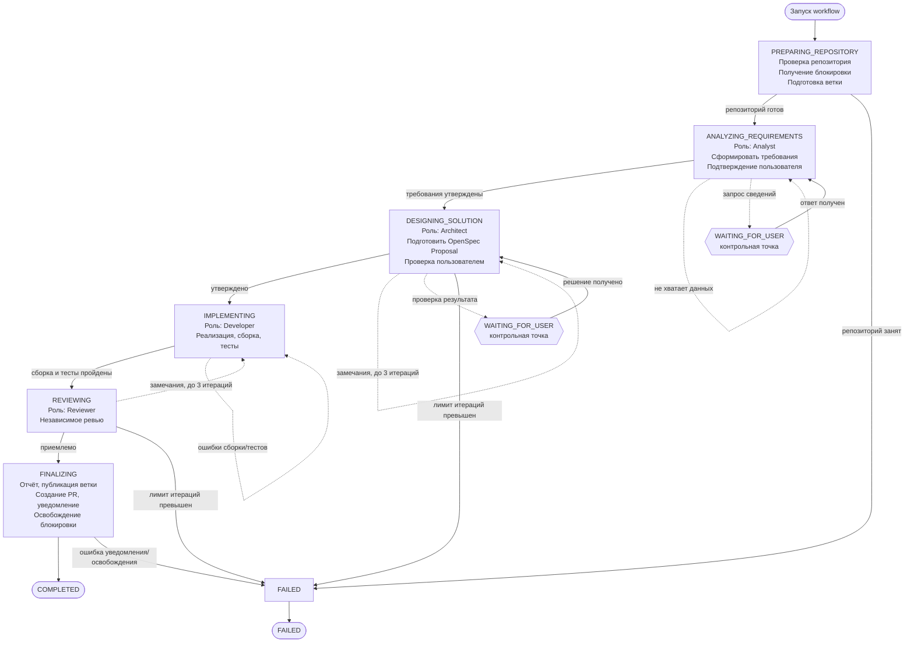
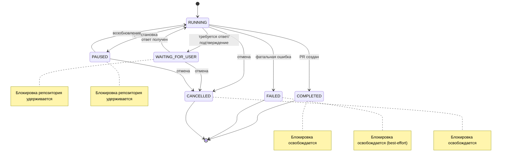
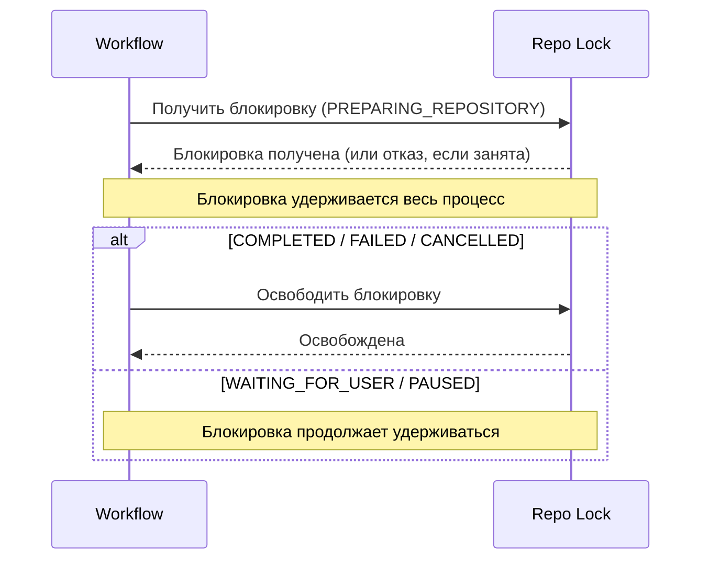

# Development Workflow

Диаграмма сквозного процесса разработки ПО от подготовки репозитория до создания Pull Request.

## 1. Последовательность этапов

## 2. Жизненный цикл состояний

## 3. Управление блокировкой репозитория

## 4. Классификация ошибок

| Тип | Примеры | Результат |
|---|---|---|
| Повторяемая | ошибки сборки/тестов, замечания ревью | повторная итерация (лимит 3 в `DESIGNING_SOLUTION` и `REVIEWING`) |
| Фатальная | недоступность Git/GitHub, потеря блокировки, нарушение целостности | `FAILED` |
